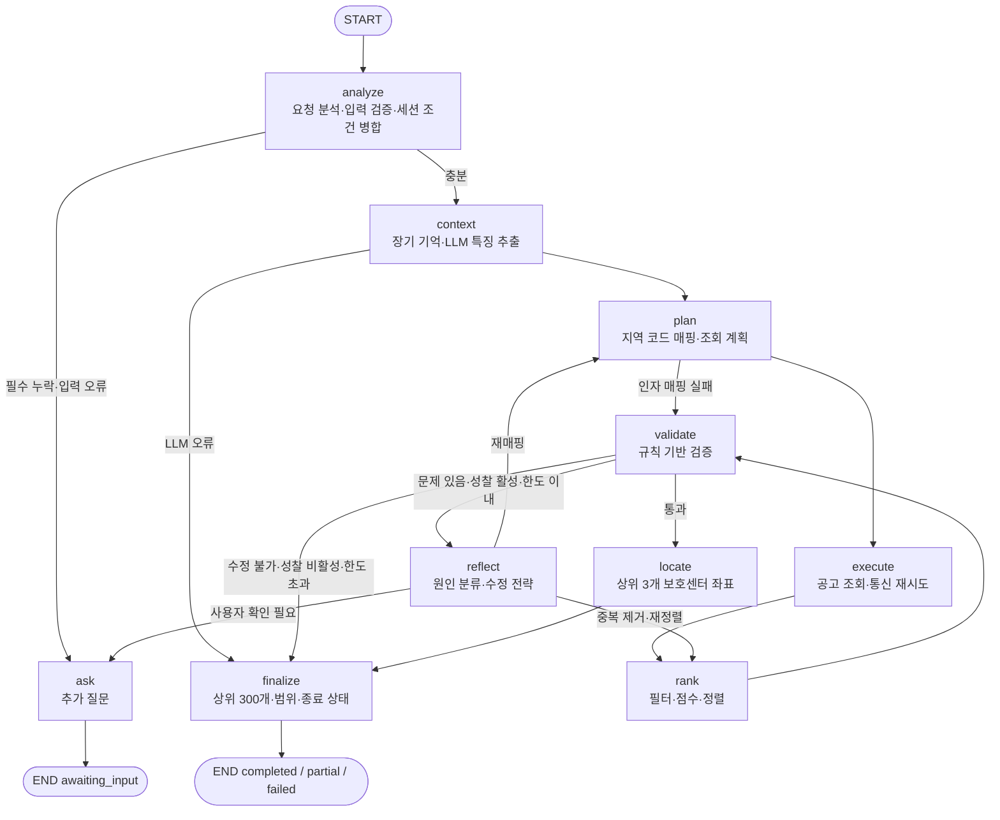
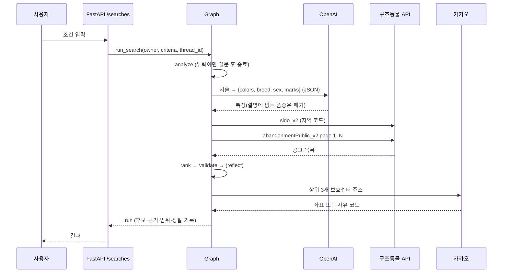
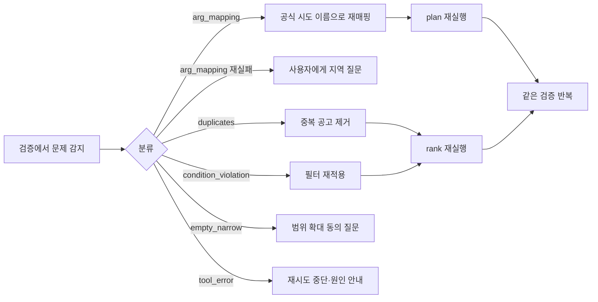

# 에이전트 아키텍처 설계서 (초안 v0.2)

> 코드 기준: `backend/agent/graph.py`, `backend/agent/state.py`, `backend/agent/runner.py`
> 노드·상태 필드·도구 스키마가 바뀌면 이 문서를 함께 고친다(AGENTS.md 7).

## 1. 전체 구성

```text
React(Vite) ──/api/v1──▶ FastAPI ──▶ LangGraph 검색 그래프 ──▶ 도구(구조동물 API · 카카오 · OpenAI)
                           │                     │
                           ├─ Redis: 세션·호출 제한   └─ 저장소(SQLite | Supabase documents)
```

| 화면(라우트) | 디자인 원본 | 사용하는 API |
| --- | --- | --- |
| `/` 전체 공고 | `img/dasimanna-cards-board.html` | `GET /notices`, `GET /regions` |
| `/notices/:id` 공고 상세 | `img/dasimanna-cards-detail.html` | `GET /notices/{id}` 또는 `GET /runs/{run_id}` + 위치 API. '구조 위치' 옆 🗺️ 버튼은 구조 위치 글(`happen_place`)을 브라우저 카카오 SDK(주소 검색 → 장소 검색)로 찾아 작은 지도 창에 표시(좌표 저장 안 함, 못 찾으면 카카오맵 링크만). 창 밖 클릭·Esc 로 닫힘 |
| `/search` 우리 아이 찾기(로그인) | `img/dasimanna-cards-search.html` | `POST /photo-analysis`, `POST /searches`, `GET /runs`, `GET /runs/{id}`. 실종 지역은 카카오 지도 모달에서 고른 위치의 시·도를 `/regions` 공식 이름으로 맞춰 `region` 으로, 주소를 `lost_place` 로 보낸다(브라우저 카카오 SDK, `VITE_KAKAO_JS_KEY`) |
| `/my` 마이페이지(로그인) | `img/dasimanna-cards-my.html` | `GET /auth/me`(내 정보: 이름·이메일), `GET /runs?limit=50`(검색 기록, 화면에서 5개씩 페이지 나눔), `GET /posts/mine`(내가 쓴 게시글). 기록을 누르면 `/search?run=<run_id>` 로 이동해 `GET /runs/{id}` 결과를 다시 보여 준다 |
| `/board` 실종 정보 게시판 | `img/dasimanna-cards-board.html`(실종 정보 게시판 영역) | `GET /posts`, `GET /regions`, 등록 `POST /posts`(로그인). 읽기는 공개 |
| `/board/:postId` 실종 정보 상세 | `img/dasimanna-cards-post-detail.html` | `GET /posts/{id}`, `GET /posts/{id}/photo`, 삭제 `DELETE /posts/{id}`(작성자) |
| `/login` 로그인·회원가입 | `img/dasimanna-cards-auth.html` | `/auth/*` |

## 2. StateGraph



### 노드 입출력과 전이 조건

| 노드 | 읽는 상태 | 갱신 상태 | 다음 노드 |
| --- | --- | --- | --- |
| `analyze` | `request`(+세션 조건) | `criteria`, `missing`, `input_errors`, `questions`, `context_summary.origin` | 누락·오류 → `ask`, 아니면 `context` |
| `ask` | `criteria`, `raw_items` | `status=awaiting_input`, `scope` | END |
| `context` | `criteria`, `profile_id` | 기억으로 선택 항목 보완, `memory_used`, `llm_features`, `error`(LLM) | 오류 → `finalize`, 아니면 `plan` |
| `plan` | `criteria`, `pending_fix` | `criteria.region_code`, `plan`, `issues(arg_mapping)` | 매핑 실패 → `validate`, 아니면 `execute` |
| `execute` | `criteria`, 한도 설정 | `raw_items`, `total_count`, `pages_fetched`, `retry_count`, `error` | `rank` |
| `rank` | `raw_items`, `criteria`, `llm_features`, `pending_fix.dedupe`, `semantic_scores` | `candidates`, `semantic_scores`, `ranking_method`, `error` | `validate` |
| `validate` | `candidates`, `issues`, `error` | `issues` | 아래 표 |
| `reflect` | `issues`, `reflection_count` | `reflections`, `reflection_count`, `pending_fix`, `questions` | `pending_fix.next` |
| `locate` | `candidates[:3]` | `candidates[].location` | `finalize` |
| `finalize` | 전체 | `candidates[:300]`, `scope`, `status`, `end_reason`, `partial` | END |

`validate` 이후: 수정 가능한 문제(`FIXES`)가 없으면 `locate`(오류가 있으면 `finalize`), 성찰이 꺼져 있거나 `reflection_count ≥ MAX_REFLECTIONS` 이면 `finalize`, 그 밖에는 `reflect`.

## 3. 도구 선택 정책

| 상황 | 선택 | 근거 기록 |
| --- | --- | --- |
| 필수 조건(종류·지역·기간) 누락·오류 | 도구 호출 없이 질문 | `questions` |
| 지역이 '전체'가 아님 | `animal_regions` → 공식 시도 코드 매핑 | `tool_calls[].reason` |
| 조건 충분 | `animal_search(page=1, rows=1000)` 1회(통신 재시도 별도) | 페이지·건수 |
| live 모드 + 자유 서술 있음 | `llm_feature_extract` (특징만 구조화) | 모델·프롬프트 버전 |
| 검증 통과 + 카카오 키 + 주소 | 상위 3개만 `kakao_geocode` | 후보 ID |
| 로그인 사용자가 사진 선택 | `photo_analyze` (Pillow 검증 후 OpenAI 비전) | 적합성 판정·특징 JSON |

호출 한도 `MAX_TOOL_CALLS` 를 넘으면 `tool_budget` 으로 멈춘다. 상세·보호센터 전용 공공 API 는 없으므로 검색 응답 필드에서 정규화한다(만들어내지 않음).

### Function Calling 시퀀스 (live 모드)



## 4. 상태 필드

| 이름 | 의미 | 타입 | 초기값 | 갱신 노드 | 영속 |
| --- | --- | --- | --- | --- | --- |
| `run_id` / `thread_id` / `owner` | 실행·세션·소유자 키 | str | runner | runner | run, thread |
| `profile_id` | 장기 기억 동물 프로필 | str \| None | 요청 | — | — |
| `request` | 원 입력 + 세션 조건 | dict | runner | — | — |
| `criteria` | 정규화 조건 | `Criteria` | — | analyze, context, plan | run, thread(기억 출처 제외) |
| `missing` / `input_errors` / `questions` | 누락·오류·질문 | list | [] | analyze, reflect | run, thread |
| `memory_used` | 장기 기억에서 채운 값 | dict | {} | context | run |
| `llm_features` | LLM 추출 특징 | dict | — | context | run |
| `context_summary` | 값 출처, 모델 입력 필드 | dict | — | analyze, context | run |
| `plan` | 조회 계획 | list | — | plan | run |
| `tool_calls` | 도구 호출 기록(누적) | list | [] | plan, execute, context, locate | run |
| `raw_items` / `total_count` / `pages_fetched` / `fetched_at` / `data_source` | 조회 결과·범위 | | — | execute | run(scope) |
| `retry_count` | 통신 실패 재시도 수 | int | 0 | execute | run |
| `candidates` | 후보(점수·근거·위치) | list | — | rank, locate, finalize | run |
| `issues` | 검증 문제 | list | — | plan, validate, reflect, finalize | run |
| `reflection_enabled` | 성찰 사용 여부(평가 변수) | bool | True | — | run |
| `reflection_count` / `reflections` | 판단 오류 수정 횟수·기록(누적) | int / list | 0 / [] | reflect | run |
| `pending_fix` | 다음 수정 지시 | dict \| None | — | reflect, plan, rank, execute | — |
| `status` / `end_reason` / `partial` / `scope` / `error` | 종료 정보 | | — | ask, finalize | run |
| `trace` | 거친 노드 순서(누적) | list | [] | 모든 노드 | run |

## 5. 기억·컨텍스트

- 적용 순서: 현재 요청 → 같은 세션(`thread` 문서) → 장기 기억(`memory` 문서, 선택 특징만) → 기본값. 출처는 `context_summary.origin` 에 남긴다.
- 장기 기억은 사용자가 `PUT /memory` 로 확인한 특징만 저장한다. 검색 범위(종류·지역·기간)는 저장하지 않는다. LLM 추정값은 저장하지 않는다.
- 모델 입력은 자유 서술(최대 1,000자)뿐이다. 이메일·연락처·키는 넣지 않는다.
- 체크포인트: 한 요청 안에서 그래프가 끝까지 실행되고, 추가 질문 상태는 `thread` 문서에 저장되므로 재시작 후 같은 `thread_id` 로 이어 간다.
- 요약 전략(토큰 예산·요약 임계값)은 **미구현**. 현재 LLM 입력은 단일 서술이라 요약이 필요하지 않다. 대화형 입력을 늘리면 추가한다.

## 6. 자가 성찰 (Activity)



- 통신 실패(타임아웃·네트워크·서버 오류·호출 제한)는 `execute` 안에서 0.5초·1초 백오프로 최대 2회 재시도하고 `retry_count` 로 센다. 판단 오류 수정은 `reflection_count` 로 따로 센다.
- 인증 오류는 재시도하지 않는다. 실패를 샘플 데이터로 덮지 않는다.
- 조건을 조용히 완화하지 않는다. 빈 결과에서 지역 확대는 사용자 확인을 받는다.

## 7. 후보 정렬 규칙

`backend/agent/ranking.py`: 품종 3 · 털색 3 · 성별 2 · 특징 키워드 1(최대 3). 누락 필드는 `unknown`, 다른 값은 `mismatched`. 동점은 점수 → 실종일과 가까운 발견일 → 공고 ID. 이 규칙 순위와 전체 공고 임베딩의 코사인 순위를 RRF(k=60)로 합쳐 최대 300건을 보관한다. 화면은 페이지당 20건을 보여 준다. 점수는 같은 동물일 확률이 아니다.

## 8. 백엔드 API 계약 (요약)

| 경로 | 인증 | 주요 오류 코드 |
| --- | --- | --- |
| `GET /health` | 없음 | — |
| `GET /regions` | 없음 | `animal_*` |
| `GET /notices` · `GET /notices/{id}` | 없음 | `animal_*`, `notice_not_cached` (화면 설계로 추가한 조회 전용 경로) |
| `POST /auth/register` · `login` · `GET /auth/me` · `POST /auth/logout` | 쿠키 | `email_taken`, `invalid_credentials`, `login_rate_limited`, `auth_unavailable` |
| `POST /searches` | 필요 | `not_authenticated`, `invalid_request` |
| `POST /photo-analysis` | 필요 | `photo_analysis_not_configured`, `photo_analysis_rate_limited`, `invalid_photo`, `photo_too_large`, `photo_too_many_pixels`, `unsupported_photo_format`, `llm_*` |
| `GET /runs` · `GET /runs/{id}?page=1&page_size=20` | 필요(소유자) | `run_not_found`, `invalid_page`, `search_cache_unavailable` |
| `GET /runs/{id}/candidates/{cid}` | 필요(소유자) | `candidate_not_found` |
| `GET /runs/{id}/candidates/{cid}/location` | 필요(소유자) | `candidate_not_found`, `location_*`(502), `location_rate_limited` |
| `GET/POST /saved-searches` · `DELETE /saved-searches/{key}` | 필요 | `saved_search_not_found` |
| `GET /memory/{pid}` · `PUT /memory` · `DELETE /memory/{pid}` | 필요 | `memory_not_found` |
| `GET /posts` · `GET /posts/{id}` · `GET /posts/{id}/photo` | 없음(공개) | `post_not_found`, `photo_not_found` |
| `GET /posts/mine` | 필요 | `not_authenticated`. 로그인 사용자가 쓴 글만(작성자 키는 세션에서 읽음, 응답에 미포함) |
| `POST /posts` · `DELETE /posts/{id}` | 필요(삭제는 작성자만) | `not_authenticated`, `lost_date_future`, `lost_date_too_old`, `photo_invalid`, `photo_too_large`(413), `post_limit`(429), `post_forbidden`(403) |
| `/subscriptions`, `/notifications` | — | **미구현** |

실종 정보 게시판은 사용자별 격리의 예외인 공개 데이터다. 게시글은 공용 소유자 키 `board` 아래 `kind=post` 문서로 저장하고, 작성자 키는 `data.author` 에만 두어 응답에는 `mine`(내 글 여부)만 내보낸다. 실종 위치는 검색 화면과 같은 지도 선택창(`RegionPicker`, `allowAll=false`)으로 받아 공식 시·도 이름(`region`)과 동 단위 주소(`lost_place`)만 저장한다(좌표는 저장하지 않음). 연락처는 받지 않고, 사진은 브라우저에서 긴 변 1024px JPEG 로 줄인 data URL(400KB 이하, JPG·PNG·WebP)만 받는다. 한 사람당 게시글은 10개까지다. 그래프 도구(`board_search`)와는 아직 연결하지 않았다.

모든 변경 요청은 Origin 을 검사해 `403 origin_not_allowed` 로 막고, 응답에는 `Cache-Control: no-store` 를 붙인다.

## 9. 미구현·미확정

- 알림(구독·Discord DM·발송 이력), 브라우저 푸시
- 대화 요약 전략
- 구조동물 API 응답 필드는 문서 기준으로 정규화했고, 실제 키 응답 확인이 필요하다(`docs/test-report.md`).

개발·환경변수·배포 설정은 [docs/development.md](development.md)를 참고한다.

### 사진 분석 흐름

- 브라우저에서 JPG·PNG·WEBP, 8MB 이하 파일을 고르고 base64 JSON으로 `POST /photo-analysis`에 보낸다. 서버는 인증 사용자별 분당 5회로 제한한다.
- `backend/agent/photo.py`가 Pillow로 실제 포맷·파일 무결성을 확인하고, 픽셀 수가 2,000만을 넘으면 거부한다. 파일은 처리 후 저장하지 않는다.
- `backend/agent/llm.py`의 `PHOTO_SYSTEM_PROMPT`가 동물 존재, 외형 식별 가능 여부, 특정 동물의 중심·구분 가능 여부를 각각 판단한다. 세 조건과 각 자동 입력 특징 신뢰도가 0.8 이상인 값만 반환한다.
- 분석 특징은 검색 폼에 입력되고 사용자가 수정할 수 있다. 낮은 신뢰도·분석 오류는 업로드 영역 아래에 표시한다. 폼 입력에 성공하면 `PhotoFeedbackPopup`이 하단 중앙에 나타난다(데스크톱 50vw, 모바일 80vw). 좋아요·싫어요 값은 현재 화면 상태에만 반영하고 서버에 저장하지 않는다.
- 사진 분석에는 `OPENAI_API_KEY`가 필요하며, local 모드에서도 키가 설정된 경우 사용할 수 있다. 설정이 없으면 503 오류를 반환한다.

## 10. 조건 캐시·RRF·페이지네이션 (v0.2)

- 실행 전 현재 요청 → 세션 → 확인된 기억을 병합·정규화한 뒤 사용자 ID, 조건, 출처, 모델, 성찰 옵션, 버전을 정렬 JSON으로 직렬화하여 SHA-256 해시 키(`meet-again:search:<digest>`)를 만든다. 필수 조건이 빠지거나 잘못되면 캐시/공고 조회 없이 기존 질문 흐름으로 간다.
- Redis GET이 적중하면 그래프·공공 API·LLM·임베딩을 실행하지 않는다. 응답마다 새로운 사용자별 run/thread 기록을 만들되 실제 호출 수는 0으로 기록한다.
- 미적중은 Redis NX 잠금 후 다시 GET한다. 그래프 실행은 최대 120초, 잠금은 150초이며 대기는 최대 125초다. 잠금 소유 토큰을 WATCH로 확인한 뒤 해제한다. Redis 장애는 503, 잠금 대기 초과는 409, 실행 시간 초과는 504다.
- 공고는 1,000건 한 페이지를 조회한다. 실제 전체가 더 크면 `scope.complete=false`와 실제 조회 건수를 표시한다. API 통신 실패 재시도 규칙은 유지한다. `MAX_SEARCH_PAGES`는 호환용 필드이며 조회량에 영향을 주지 않는다.
- `embeddings.py`는 `text-embedding-3-small`에 검색 특징 + 공고 전부를 128개 단위로 보내고 응답 인덱스/개수/1,536차원/유한값/영벡터를 검사한다. 이메일·전화·좌표·ID는 공고 임베딩 텍스트에 넣지 않는다. 벡터는 그래프 실행 안에서만 사용한다.
- 기존 규칙 순위와 코사인 순위의 RRF 합산 점수는 `1/(60+rank_lexical)+1/(60+rank_semantic)`이다. `score`는 RRF 점수이며 기존 점수는 `lexical_score`, 유사도는 `semantic_score`, 순위 근거는 `rrf_ranks`로 반환한다. 점수는 동일 개체일 확률이 아니다.
- 상태에 `semantic_scores`(공고 ID→코사인 점수, rank에서 갱신, 비영속), `ranking_method`(rrf/sample_lexical, 실행 이력 저장)를 추가했다. 성찰 재정렬은 이미 계산한 유사도를 재사용한다.
- 성공한 결과는 상위 최대 300건 및 실행 메타데이터만 TTL 600초로 저장한다. 원본 목록·벡터·사용자 ID·run/thread ID는 조건 캐시 값에서 제외한다. 캐시 조회로 TTL을 연장하지 않는다. 오류·질문 상태는 캐시하지 않는다. 신규 공고 감지를 위한 주기적 조회는 없다.
- 실행 이력에도 상위 300건을 저장한다. `snapshot_id`를 비교해 같은 조건이 만료 후 갱신되더라도 기존 이력의 후보를 다른 스냅샷으로 교체하지 않는다. Redis 만료 후의 이력 조회는 저장소를 사용하며 API/임베딩을 재실행하지 않는다.
- `POST /searches`와 `GET /runs/{id}`의 후보는 기본 20건만 반환한다. `pagination={page,page_size,total,pages}`, 페이지 크기 최대 40, `cache_hit`, `ranking_method`를 포함한다. 후보 상세/좌표는 전체 저장 이력에서 소유자와 후보를 확인한다.
- `SearchViewProvider`를 Routes 위에 두어 검색 폼·지역·결과 페이지를 유지한다. `react-router-dom`의 `/search?run=<id>&page=<n>`과 메모리 캐시(최대 45페이지, 10분)를 함께 사용한다. 상세 화면 뒤로가기 시 페이지와 스크롤을 복원한다. 계정이 바뀌면 Provider를 초기화한다. 새로고침은 URL의 실행 ID/페이지로 이력을 다시 읽는다.
- 전체 공고(`/`)는 특징 쿼리가 없는 별도 목록이므로 기존 조회 경로를 유지한다. 위 RRF·300건·페이지네이션 계약은 맞춤 검색(`/search`)에 적용된다.
