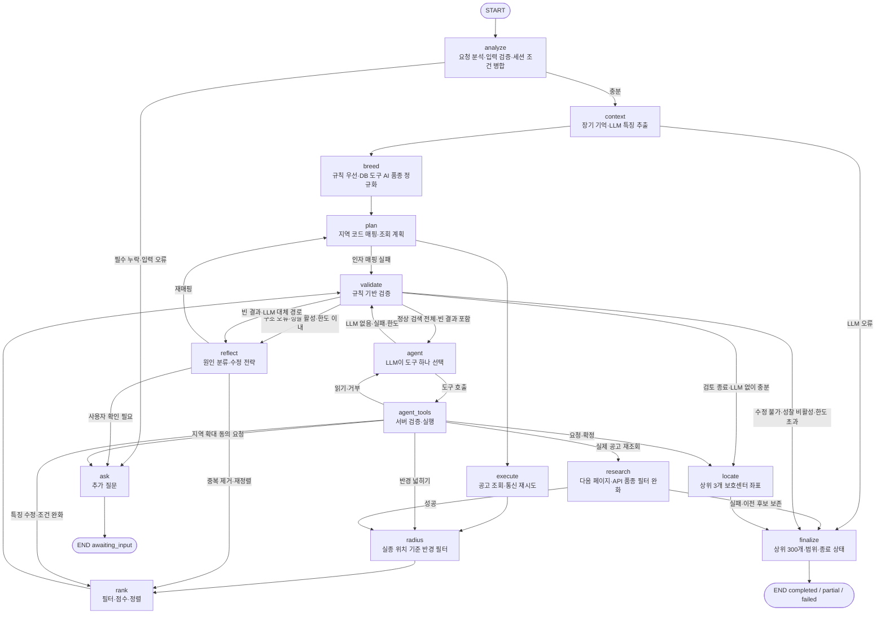
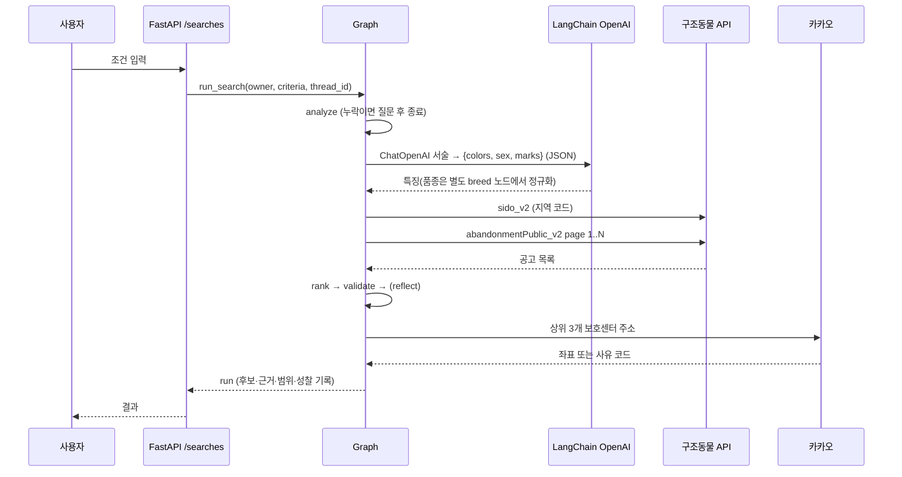
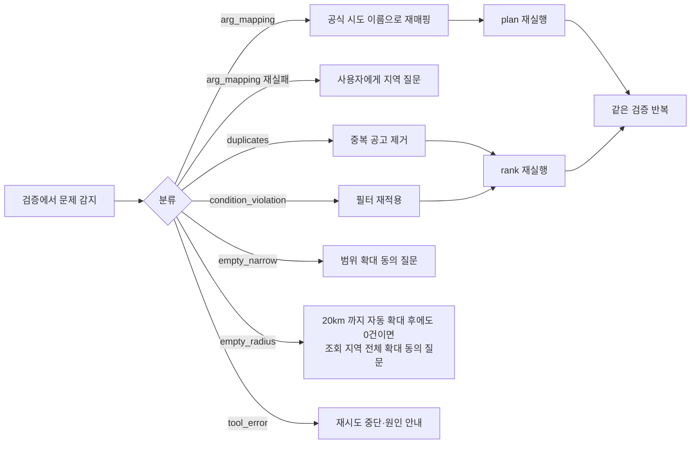

# 에이전트 아키텍처 설계서 (초안 v0.2)

> 코드 기준: `backend/agent/graph.py`, `backend/agent/state.py`, `backend/agent/runner.py`
> 노드·상태 필드·도구 스키마가 바뀌면 이 문서를 함께 고친다(AGENTS.md 7).

## 1. 전체 구성

```text
React(Vite) ──/api/v1──▶ FastAPI ──▶ LangGraph 검색 그래프 ──▶ 도구(구조동물 API · 카카오 · LangChain OpenAI)
                           │                     │
                           ├─ Redis: 세션·호출 제한   └─ 저장소(SQLite | Supabase documents)
                           └─ (선택) LangSmith: 그래프·모델 실행 추적
```

| 화면(라우트) | 디자인 원본 | 사용하는 API |
| --- | --- | --- |
| `/` 전체 공고 | `img/dasimanna-cards-board.html` | `GET /notices`, `GET /regions` |
| `/notices/:id` 공고 상세 | `img/dasimanna-cards-detail.html` | `GET /notices/{id}` 또는 `GET /runs/{run_id}` + 위치 API. '구조 위치' 옆 🗺️ 버튼은 구조 위치 글(`happen_place`)을 브라우저 카카오 SDK(주소 검색 → 장소 검색)로 찾아 작은 지도 창에 표시(좌표 저장 안 함, 못 찾으면 카카오맵 링크만). 창 밖 클릭·Esc 로 닫힘 |
| `/search` 우리 아이 찾기(로그인) | `img/dasimanna-cards-search.html` | `POST /photo-analysis`, `POST /searches`, `GET /runs`, `GET /runs/{id}`. 실종 지역은 카카오 지도 모달에서 고른 위치의 시·도를 `/regions` 공식 이름으로 맞춰 `region` 으로, 주소를 `lost_place` 로 보낸다(브라우저 카카오 SDK, `VITE_KAKAO_JS_KEY`) |
| `/my` 마이페이지(로그인) | `img/dasimanna-cards-my.html` | `GET /auth/me`(내 정보: 이름·이메일), `GET /runs?limit=50`(검색 기록, 화면에서 5개씩 페이지 나눔), `GET /posts/mine`(내가 쓴 게시글). 기록을 누르면 `/search?run=<run_id>` 로 이동해 `GET /runs/{id}` 결과를 다시 보여 준다, `GET /posters`(내가 만든 전단지, 누르면 `/posters/{id}` 상세) |
| `/board` 실종 정보 게시판 | `img/dasimanna-cards-board.html`(실종 정보 게시판 영역) | `GET /posts?species&region&days&page`(회원 글 + 공공데이터 분실 신고, 20건씩), `GET /regions`, 등록 `POST /posts`(로그인). 읽기는 공개 |
| `/board/:postId` 실종 정보 상세 | `img/dasimanna-cards-post-detail.html` | `GET/PATCH /posts/{id}`, `GET /posts/{id}/photo`, 삭제 `DELETE /posts/{id}`(작성자). 본문 아래 음성(최대 3개)과 댓글: 음성 `POST/GET/DELETE /posts/{id}/voices...`, 댓글 `GET/POST /posts/{id}/comments`, `DELETE /posts/{id}/comments/{comment_id}` |
| `/board/lost/:lostId` 분실 신고 상세 | 위와 같은 화면 | `GET /posts/lost/{id}`(공공데이터 분실 신고, 개인정보 제외). 삭제 없음. 댓글은 계산된 분실 신고 ID(`lost-YYYYMMDD-해시`)로 같은 댓글 API 사용 |
| `/poster` 실종 전단지 에디터(로그인) | `docs` 기반 MVP | `GET /poster/templates`, `GET /poster/templates/{id}`, `POST /poster/assets`, `POST /poster/assets/from-post`(게시판 글 사진 복사), `POST/GET/PUT/DELETE /posters/{id}`. 저장 후에는 편집기에 머물며 '저장되었습니다.'만 안내한다(새 전단지는 주소만 `?edit={id}` 로 바꿔 다음 저장이 수정이 되게 함) |
| `/posters/:posterId` 전단지 상세(로그인) | — | `GET /posters/{id}`. 읽기 전용 캔버스(화면 폭에 맞춰 축소), 오른쪽 위 '수정' → `/poster?edit={id}` |
| `/login` 로그인·회원가입 | `img/dasimanna-cards-auth.html` | `/auth/*` |
| `/admin` 관리자(관리자 계정만) | — | `GET /admin/overview`(연동·저장소·Redis 상태, 버전·한도), `GET /admin/agent/stats`(에이전트 집계·성찰 켬/끔 비교), `GET /admin/runs`·`GET/DELETE /admin/runs/{owner}/{run_id}`, `GET/PATCH /admin/users`, `GET /admin/posts`·`DELETE /admin/posts/{id}`, `GET /admin/comments`·`DELETE /admin/comments/{post_id}/{id}`, `GET /admin/posters`·`DELETE /admin/posters/{owner}/{id}`, `GET /admin/logs`. 헤더 '관리자' 메뉴는 `GET /auth/me` 의 `is_admin` 이 참일 때만 보인다 |

## 2. StateGraph



### 노드 입출력과 전이 조건

| 노드 | 읽는 상태 | 갱신 상태 | 다음 노드 |
| --- | --- | --- | --- |
| `analyze` | `request`(+세션 조건) | `criteria`, `missing`, `input_errors`, `questions`, `context_summary.origin` | 누락·오류 → `ask`, 아니면 `context` |
| `ask` | `criteria`, `raw_items` | `status=awaiting_input`, `scope` | END |
| `context` | `criteria`, `profile_id` | 기억으로 선택 항목 보완, `memory_used`, `llm_features`, `error`(LLM) | 오류 → `finalize`, 아니면 `plan` |
| `plan` | `criteria`, `pending_fix` | `criteria.region_code`, `plan`, `issues(arg_mapping)` | 매핑 실패 → `validate`, 아니면 `execute` |
| `execute` | `criteria`, 한도 설정 | `raw_items`, `total_count`, `pages_fetched`, `retry_count`, `error` | `radius` |
| `research` | 서버가 검증한 `agent_search_plan`, 이전 조회·후보, 남은 도구 예산 | 성공 시 원본·조회 조건·페이지·범위 갱신, 실패 시 이전 조건/후보 보존·오류 기록 | 성공 → `radius`, 실패 → `finalize` |
| `radius` | `criteria.lost_place`·`lost_date`·`radius_step`, `raw_items` | `radius`, `radius_items`, `tool_calls(kakao_geocode_regions)` | `rank` |
| `rank` | `radius_items`(없으면 `raw_items`), `criteria`, `llm_features`, `pending_fix.dedupe`, `semantic_scores` | `candidates`, `semantic_scores`, `ranking_method`, `error` | `validate` |
| `validate` | `candidates`, `issues`, `error`, `agent_done` | `issues`, `confidence`(빈 결과 포함) | 구조 오류 → `reflect`, 정상·빈 결과 → `agent`, 검토 종료 → `locate` |
| `reflect` | `issues`, `reflection_count` | `reflections`, `reflection_count`, `pending_fix`, `questions` | `pending_fix.next` |
| `agent` | 조건·후보·조회/필터 건수·확신·대화 이력 | LLM 메시지·걸음·판단 기록 | 도구 선택 → `agent_tools`, LLM 없음/실패/한도 → `validate` |
| `agent_tools` | 선택한 도구·인자·서버 허용 규칙 | 조건·다시 찾기 수·재조회 계획·요청·판단 기록 | 수정 → `rank`/`radius`, 재조회 → `research`, 지역 확대 확인 → `ask`, 거부 → `agent`, 요청/확정 → `locate` |
| `locate` | `candidates[:3]` | `candidates[].location` | `finalize` |
| `finalize` | 전체 | `candidates[:300]`, `scope`, `status`, `end_reason`, `partial` | END |

`validate` 이후: 중복·조건 위반·지역 매핑 오류는 기존 성찰 경로로 처리한다. 성찰이 꺼져 있거나 `reflection_count ≥ MAX_REFLECTIONS`이면 수정하지 않고 `finalize`한다. 조회·정렬이 정상 완료되면 LLM이 설정된 모든 검색(빈 결과 포함)을 `agent`가 검토한다. 빈 결과의 `empty_narrow`/`empty_radius`는 LLM의 종료 선택 시 해소하고, LLM 없음·실패·한도 초과 시 기존 성찰/넓히기 질문으로 돌아간다. 도구 오류와 입력 누락은 검토하지 않는다. `reflection_enabled`는 규칙 성찰의 비교 변수이며 LLM 검토 여부를 끄는 설정은 아니다.

조건 캐시 사용 시 `GRAPH`는 `_defer_agent` 내부 설정으로 검토 직전 `validate`에서 일단 종료한다. 조회 상태를 캐시하고 잠금을 해제한 뒤 `REVIEW_GRAPH`가 `validate`부터 실행한다. 캐시 적중도 같은 경로로 현재 대화의 이력으로 검토하며, 두 단계의 실행 시간 합계는 요청당 120초 이내다. 검토 결과는 `조건 캐시 키 + 대화 맥락(agent_history: 이미 한 사진·정보 요청과 거절, 사진 분석)` 키(`review_cache_key`)로 같은 TTL 동안 따로 캐시한다. 같은 조회 결과에 같은 맥락이면 LLM·재조회 없이 이전 판단을 돌려주고(`review_cache_hit=true`, `agent_decision.cached=true`, trace `[cache_hit, review_cache_hit]`), 사진을 요청한 뒤처럼 맥락이 바뀌면 키가 달라져 새로 판단한다.

## 3. 도구 선택 정책

| 상황 | 선택 | 근거 기록 |
| --- | --- | --- |
| 필수 조건(종류·지역·기간) 누락·오류 | 도구 호출 없이 질문 | `questions` |
| 지역이 '전체'가 아님 | `animal_regions` → 공식 시도 코드 매핑 | `tool_calls[].reason` |
| 최초 조건 충분 | `animal_search(page=1, rows=1000)` 1회(통신 재시도 별도) | 페이지·건수 |
| 확신 낮음·미조회 페이지 또는 API 품종 제한 | 기존 에이전트가 `search_notices(next_page\|relax_breed)` 선택 → 실제 공고 API 최대 1회 재조회 | `agent_decision.log`, `researches`, `tool_calls` |
| 다른 지역 조회 필요 | `search_notices(widen_region)`은 `ask`로 종료. 사용자가 전체 지역 버튼을 누르면 같은 세션의 새 요청으로 조회 | `questions.field=region`, 사용자 후속 `criteria.region=all` |
| 품종 코드 선택 | 코드 목록에서 품종명을 검증하고 공공 API에 `kind=<breed_code>` 전달, 응답 품종명도 확인 | `criteria.breed_code`, `kind` |
| live 모드 + 자유 서술 있음 | LangChain `ChatOpenAI` 기반 `llm_feature_extract` (특징만 구조화) | 모델·프롬프트 버전 |
| LLM 설정 + 정상 조회·정렬 완료(빈 결과·캐시 적중 포함) | `agent`가 결과 검토 후 수정·질문·확정 선택. 확신 충분이면 사진·정보 요청은 서버가 거부 | `agent_decision`, `tool_calls[].agent_*` |
| 결과 0건 + 에이전트가 `finish` + 더 넓힐 지역·반경이 있음(`empty_narrow`·`empty_radius`) | 판단을 기록하고 `validate`로 돌아가 기존 성찰 질문(지역·반경 넓히기 동의)으로 끝낸다. 지역 전체처럼 넓힐 범위가 없으면 0건 완료 | `agent_decision.empty_fallback`, `questions` |
| 실종 위치(`lost_place`) + 카카오 키 + 실종 14일 이내 | `kakao_geocode_regions`: 실종 위치(좌표가 없을 때)·공고 관할 시군구·구조 장소 읍면동 좌표(성공만 캐시, 검색당 신규 80건 상한) | 반경 km·요청·캐시 수 |
| 검증 통과 + 카카오 키 + 주소 | 상위 3개만 `kakao_geocode` | 후보 ID |
| 로그인 사용자가 사진 선택 | `photo_analyze` (Pillow 검증 후 LangChain `ChatOpenAI` 비전) | 적합성 판정·특징 JSON |

호출 한도 `MAX_TOOL_CALLS` 를 넘으면 `tool_budget` 으로 멈춘다. 상세·보호센터 전용 공공 API 는 없으므로 검색 응답 필드에서 정규화한다(만들어내지 않음).

### Function Calling 시퀀스 (live 모드)



## 4. 상태 필드

| 이름 | 의미 | 타입 | 초기값 | 갱신 노드 | 영속 |
| --- | --- | --- | --- | --- | --- |
| `run_id` / `thread_id` / `owner` | 실행·세션·소유자 키 | str | runner | runner | run, thread |
| `profile_id` | 장기 기억 동물 프로필 | str \| None | 요청 | — | — |
| `request` | 원 입력 + 세션 조건 | dict | runner | — | — |
| `criteria` | 정규화 조건 | `Criteria` | — | analyze, context, breed, plan | run, thread(기억 출처 제외) |
| `missing` / `input_errors` / `questions` | 누락·오류·질문 | list | [] | analyze, reflect | run, thread |
| `memory_used` | 장기 기억에서 채운 값 | dict | {} | context | run |
| `llm_features` | LLM 추출 특징 + 쓸 만한 사진의 특징(`photo_store.merge_features`) | dict | — | context, agent_tools | run |
| `photo_features` | 서버가 보관한 사진 분석 결과(`suitable`, 종류·품종·털색·성별·특징). 사진을 받았는지 판단은 이 값으로만 | dict \| None | 요청 `photo_analysis_id` | runner | run |
| `context_summary` | 값 출처, 모델 입력 필드 | dict | — | analyze, context | run |
| `plan` | 조회 계획 | list | — | plan | run |
| `tool_calls` | 도구 호출 기록(누적) | list | [] | plan, execute, context, locate | run |
| `raw_items` / `total_count` / `pages_fetched` / `fetched_at` / `data_source` | 조회 결과·범위 | | — | execute | run(scope) |
| `search_query` | 실제 API에 쓴 지역·기간·종류·품종 인자. 로컬 조건과 API 필터의 차이를 구분 | dict | execute | execute, research | 검토 전 조건 캐시에만 |
| `retry_count` | 통신 실패 재시도 수 | int | 0 | execute | run |
| `radius` | 반경 단계·km·중심 좌표·포함/미확인/제외 건수·미적용 사유 | dict | — | radius | run, scope |
| `radius_items` | 반경 안 + 거리 미확인 공고(반경 밖 제외, 임베딩 대상) | list \| None | None | radius | — |
| `candidates` | 후보(점수·근거·위치) | list | — | rank, locate, finalize | run |
| `confidence` | 결과 확신 신호 `{low, reasons, signals, version}` | dict \| None | — | validate | run(캐시 포함) |
| `agent_history` | 같은 대화에서 이미 한 요청 수·물은 항목·'모르겠어요' 항목 | dict | thread | runner | thread(`agent`) |
| `agent_request` | 에이전트가 끝내며 고른 화면 요청(`photo` 또는 `info`+보기) | dict \| None | — | agent_tools | run(캐시 제외) |
| `agent_decision` | 에이전트 기록(출처 llm/no_llm/llm_error/step_limit/no_tool_call/tool_error, 마지막 도구, 걸음·다시 찾기·실제 재조회 전략 시도 수 `researches`, 단계별 log, 프롬프트 버전) | dict \| None | — | agent, agent_tools, research | run(캐시 제외) |
| `agent_messages` | LLM 대화(시스템·신호·도구 호출·도구 결과) | list | — | agent, agent_tools | 저장 안 함 |
| `agent_steps` / `agent_reruns` | LLM 걸음 수 / 재정렬·반경 변경·API 재조회 전략 시도 수 | int | — | agent / agent_tools | 저장 안 함 |
| `agent_researches` / `agent_search_plan` | 실제 API 재조회 전략 시도 수(최대 1) / 서버가 만든 action·조회 인자·적용할 조건·페이지 | int / dict \| None | 0 / None | agent_tools, research | 저장 안 함(수는 agent_decision에 기록) |
| `agent_done` / `agent_next` / `agent_rerun_pending` | 루프 종료 여부 / 도구 뒤 갈 노드(rank·radius) / 다시 찾은 결과 알림 필요 | — | — | agent_tools | 저장 안 함 |
| `agent_source` / `agent_before` / `agent_log` | 사용자 원문(수정 근거) / 다시 찾기 전 요약 / 단계별 기록 | — | — | agent, agent_tools | `agent_log` 는 `agent_decision.log` 로 run 에 남음 |
| `issues` | 검증 문제 | list | — | plan, validate, reflect, finalize | run |
| `reflection_enabled` | 성찰 사용 여부(평가 변수) | bool | True | — | run |
| `reflection_count` / `reflections` | 판단 오류 수정 횟수·기록(누적) | int / list | 0 / [] | reflect | run |
| `pending_fix` | 다음 수정 지시 | dict \| None | — | reflect, plan, rank, execute | — |
| `status` / `end_reason` / `partial` / `scope` / `error` | 종료 정보 | | — | ask, finalize | run |
| `trace` | 거친 노드 순서(누적) | list | [] | 모든 노드 | run |

## 5. 기억·컨텍스트

- 적용 순서: 현재 요청 → 같은 세션(`thread` 문서) → 장기 기억(`memory` 문서, 선택 특징만) → 기본값. 출처는 `context_summary.origin` 에 남긴다.
- 장기 기억은 사용자가 `PUT /memory` 로 확인한 특징만 저장한다. 검색 범위(종류·지역·기간)는 저장하지 않는다. LLM 추정값은 저장하지 않는다.
- 특징 추출 모델 입력은 자유 서술(최대 1,000자)이다. 검색 검토 모델에는 원문·현재 특징·단계별 건수·상위 후보 요약도 전달한다. 공고 번호·날짜·주소·연락처는 후보 요약에서 제외하며 이메일·키는 넣지 않는다.
- 체크포인트: 한 요청 안에서 그래프가 끝까지 실행되고, 추가 질문 상태는 `thread` 문서에 저장되므로 재시작 후 같은 `thread_id` 로 이어 간다.
- 요약 전략(토큰 예산·요약 임계값)은 **미구현**. 현재 LLM 입력은 단일 서술이라 요약이 필요하지 않다. 대화형 입력을 늘리면 추가한다.
- 특징·사진 분석은 `ChatOpenAI`, 임베딩은 `OpenAIEmbeddings`를 사용한다. 각 어댑터 생성자는 LangChain 호환 클라이언트를 선택적으로 받아 테스트에서 모의 클라이언트를 주입할 수 있다. 기본 런타임은 API 키와 timeout으로 실제 LangChain 클라이언트를 구성한다.
- 모델 입출력 규격은 `backend/schemas/llm.py`, HTTP 요청·응답 규격은 `backend/schemas/api.py`의 Pydantic 모델로 정의한다. LLM 응답은 `with_structured_output(..., method="json_schema", strict=True)`로 생성한 뒤 검증하고, 사진 분석 결과는 HTTP 응답 모델로 변환할 때 사용자 안내 문구를 구성한다. 그래프 상태·HTTP 응답 경계에서만 dict로 직렬화한다.

## 5.1 LangSmith 추적

- LangSmith 추적은 설정으로 켜고 끄며, 기본값과 환경변수는 [development.md](development.md#환경변수)에서 관리한다.
- FastAPI 설정이 `.env`에서 읽은 `LANGSMITH_*` 값을 프로세스 환경에 전달한다. LangGraph 검색 실행과 그 안의 LangChain 모델 호출은 같은 LangSmith 프로젝트로 추적된다. 조건 캐시 적중도 LLM 검토가 있으면 `REVIEW_GRAPH` 추적이 생긴다. LLM 없이 캐시 결과만 반환한 경우에는 그래프를 호출하지 않는다.
- 추적에는 그래프 입력·출력과 모델 입력·출력이 포함될 수 있다. 검색 조건의 자유 서술, 공고 후보 데이터 및 내부 `owner` 식별자가 포함될 수 있으므로 프로젝트 접근 권한과 LangSmith 데이터 보존 정책을 관리한다. API 키 등 설정 비밀 값은 그래프 입력에 넣지 않는다.
- 이 연동은 관측/추적만 제공한다. 평가자, 데이터셋, 프롬프트 관리 및 운영 알림은 별도 구성 사항이다.

## 6. 자가 성찰 (Activity)



- 통신 실패(타임아웃·네트워크·서버 오류·호출 제한)는 `execute` 안에서 0.5초·1초 백오프로 최대 2회 재시도하고 `retry_count` 로 센다. 판단 오류 수정은 `reflection_count` 로 따로 센다.
- 인증 오류는 재시도하지 않는다. 실패를 샘플 데이터로 덮지 않는다.
- 조건을 조용히 완화하지 않는다. 빈 결과에서 지역 확대는 사용자 확인을 받는다.

## 7. 후보 정렬 규칙

`backend/agent/ranking.py`: 품종 3 · 털색 3 · 성별 2 · 특징 키워드 1(최대 3). 누락 필드는 `unknown`, 다른 값은 `mismatched`. 동점은 점수 → 실종일과 가까운 발견일 → 공고 ID. LangChain `OpenAIEmbeddings`로 전체 공고를 임베딩하고 이 규칙 순위와 코사인 순위를 RRF(k=60)로 합쳐 최대 300건을 보관한다. 화면은 페이지당 20건을 보여 준다. 점수는 같은 동물일 확률이 아니다.

털색·무늬 정규화 규칙과 DB 원문 커버리지는 [color-normalization.md](color-normalization.md)를 참고한다.

## 7.1 공공 품종 기준정보

`scripts/init_kinds_sqlite.py`와 `scripts/init_kinds_supabase.py`는 저장소별로 분리한 실행 스크립트이며 공통 API 조회·정규화는 `scripts/kind_sync.py`를 사용한다. 축종 코드(개 `417000`, 고양이 `422400`, 기타 `429900`)별 전체 페이지를 조회한다. SQLite는 `scripts/bootstrap_sqlite.sql` 전체를 실행하고 `SQLITE_PATH`를 갱신한다. Supabase는 `scripts/bootstrap_schema.sql`을 SQL Editor에서 적용한 뒤 `SUPABASE_SCHEMA`의 Data API 테이블을 갱신한다. 모든 테이블·인덱스 DDL은 각 backend bootstrap SQL 파일에만 둔다.

`kinds.kind_code`는 공공 API 코드이며, `species`, 표시 이름, 공백을 제거한 `search_name`, `active`, 출처와 갱신 시각을 함께 둔다. 품종이 API에서 사라져도 행을 삭제하지 않고 비활성화해 과거 코드 참조를 유지한다. 이름 검색은 `(species, search_name)` 인덱스를 이용하며, 요청 문자열도 공백 제거 후 비교한다. 이름 자체가 대표 이름의 공백 유무를 흡수하므로 별칭으로 중복 등록하지 않는다.

`kind_aliases`는 별도 사용 별칭만 저장하고, 품종 코드 FK와 `(kind_code, search_alias)` 유일 제약 및 alias 검색 인덱스를 둔다. `backend/tools/kind_aliases.py`가 런타임 매칭과 동기화에서 함께 쓰는 큐레이션 원본이다. 분실 신고 품종명이 `푸들`이면 공식 품종 `토이 푸들` 코드에 매핑하도록 `"토이푸들": ["푸들"]` 별칭을 둔다. 런타임은 DB 별칭 행뿐 아니라 이 큐레이션 원본도 적용하므로, DB 동기화 전에도 연결된다. 정규화한 별칭이 정확히 한 품종 코드에만 일치할 때 코드를 부여한다. 이 매핑은 신고 품종이 토이 푸들이라는 보장이 아니라 검색 편의를 위한 명시적 큐레이션이다. 테이블에 출처와 타임스탬프를 두어 이후 API 변경과 alias 출처를 추적할 수 있다.

## 8. 백엔드 API 계약 (요약)

| 경로 | 인증 | 주요 오류 코드 |
| --- | --- | --- |
| `GET /health` | 없음 | — |
| `GET /regions` | 없음 | `animal_*` |
| `GET /notices` · `GET /notices/{id}` | 없음 | `animal_*`, `notice_not_cached` (화면 설계로 추가한 조회 전용 경로) |
| `POST /auth/register` · `login` · `GET /auth/me` · `POST /auth/logout` | 쿠키 | `email_taken`, `invalid_credentials`, `login_rate_limited`, `auth_unavailable` |
| `POST /searches` | 필요 | `not_authenticated`, `invalid_request` |
| `POST /photo-analysis` | 필요 | `photo_analysis_not_configured`, `photo_analysis_rate_limited`, `invalid_photo`, `photo_too_large`, `photo_too_many_pixels`, `unsupported_photo_format`, `photo_not_found`(404), `photo_source_not_allowed`, `photo_fetch_failed`, `lost_board_unavailable`(503), `llm_*` |
| `GET /runs` · `GET /runs/{id}?page=1&page_size=20` | 필요(소유자) | `run_not_found`, `invalid_page`, `search_cache_unavailable` |
| `GET /runs/{id}/candidates/{cid}` | 필요(소유자) | `candidate_not_found` |
| `GET /runs/{id}/candidates/{cid}/location` | 필요(소유자) | `candidate_not_found`, `location_*`(502), `location_rate_limited` |
| `GET/POST /saved-searches` · `DELETE /saved-searches/{key}` | 필요 | `saved_search_not_found` |
| `GET /memory/{pid}` · `PUT /memory` · `DELETE /memory/{pid}` | 필요 | `memory_not_found` |
| `GET /posts` · `GET /posts/{id}` · `GET /posts/{id}/photo` · `GET /posts/{id}/voices/{voice_id}/audio` | 없음(공개) | `post_not_found`, `photo_not_found`, `voice_not_found`. 목록 응답 `lost.status`: `ok`·`loading`·`unavailable`(+`error_code` `lost_*`)·`not_configured` |
| `GET /posts/lost/{id}` | 없음(공개) | `post_not_found`, `lost_*`(502) |
| `GET /posts/mine` | 필요 | `not_authenticated`. 로그인 사용자가 쓴 글만(작성자 키는 세션에서 읽음, 응답에 미포함) |
| `POST /posts` · `PATCH /posts/{id}` · `DELETE /posts/{id}` | 필요(수정·삭제는 작성자만) | `not_authenticated`, `lost_date_future`, `lost_date_too_old`, `photo_invalid`, `photo_too_large`(413), `post_limit`(429), `post_forbidden`(403), `invalid_breed_code`(422), `kinds_unavailable`(503) |
| `POST /posts/{id}/voices` · `DELETE /posts/{id}/voices/{voice_id}` | 필요(게시글 소유자만) | multipart `audio`와 필수 설명(1~200자), `voice_invalid`, `voice_too_large`(413, 10 MiB), `voice_too_long`(60초 초과), `voice_limit`(게시글당 3개), `voice_description_invalid`, `voice_not_found`, `post_forbidden` |
| `GET /posts/{id}/comments` | 없음(공개) | `post_not_found`(ID 형식이 아님). 오래된 순, 최대 200개, 응답에 작성자 키 미포함(`mine` 만) |
| `POST /posts/{id}/comments` · `DELETE /posts/{id}/comments/{comment_id}` | 필요(삭제는 작성자만) | `not_authenticated`, `invalid_request`(422, 빈 글·500자 초과), `post_not_found`(대상 글 없음), `lost_*`(502, 분실 신고 확인 실패), `comment_rate_limited`(429, 1분 5개), `comment_limit`(429, 글당 200개), `comment_not_found`, `comment_forbidden`(403) |
| `GET /poster/templates` · `GET /poster/templates/{id}` | 없음 | `poster_template_not_found` |
| `POST /poster/assets` · `GET /poster/assets/{asset_id}` | 필요(소유자) | `poster_asset_too_large`(413, 15MB), `poster_asset_pixels`(413, 2,500만 화소), `poster_asset_format`(415), `poster_asset_invalid`(422), `poster_asset_not_found` |
| `GET/POST /posters` · `GET/PUT/DELETE /posters/{id}` | 필요(소유자) | `poster_not_found`, `poster_component_invalid`, `poster_asset_unavailable`, `poster_limit`(422, 사용자당 5개) |
| `/admin/*` | 필요(관리자: 계정 문서 `identity.role=admin`) | `not_authenticated`(401), `admin_only`(403), `admin_protected`(422, 관리자 정지 시도), `not_found`·`run_not_found`·`post_not_found`·`comment_not_found`·`poster_not_found`(404) |
| `/subscriptions`, `/notifications` | — | **미구현** |

전단지 목록 `GET /posters`는 로그인 사용자 소유의 DB 문서만 조회해 `items=[{id,title,pet_name,template_id,template_name,lost_place,photo_asset_id,updated_at}]`, `limit=5`를 반환한다. 마이페이지에서 `/poster?edit=<id>`로 바로 편집기를 열며, 삭제 전 확인 팝업을 표시한다. 신규 저장은 백엔드가 DB에서 해당 사용자의 `kind=poster` 문서를 조회해 5개 이상이면 `422 poster_limit`으로 거부한다. 기존 문서 수정에는 개수 제한을 적용하지 않으며 삭제 후 신규 저장할 수 있다.

실종 정보 게시판은 사용자별 격리의 예외인 공개 데이터다. 게시글은 공용 소유자 키 `board` 아래 `kind=post` 문서로 저장하고, 작성자 키는 `data.author` 에만 두어 응답에는 `mine`(내 글 여부)만 내보낸다. 실종 위치는 검색 화면과 같은 지도 선택창(`RegionPicker`, `allowAll=false`)으로 받아 공식 시·도 이름(`region`)과 동 단위 주소(`lost_place`)만 저장한다(좌표는 저장하지 않음). 연락처는 받지 않고, 사진은 브라우저에서 긴 변 1024px JPEG 로 줄인 data URL(400KB 이하, JPG·PNG·WebP)만 받는다. 음성은 게시글 소유자만 추가·삭제할 수 있고 게시글당 3개·파일당 10 MiB·60초로 제한한다. 서버는 Mutagen으로 형식과 재생 시간을 검증하고 변환·압축하지 않는다. 허용 형식은 MP3·M4A/MP4·WAV·OGG Vorbis/Opus이며 파일명은 UUID로 생성한다. Supabase에서는 private Storage bucket(`post-audio`, `backend/config.py`의 코드 상수)에 바이너리를 저장하고, SQLite에서는 `POST_AUDIO_LOCAL_DIR`에 둔다. 게시글 문서에는 음성 ID·저장 키·형식·크기·길이·엔티티화된 설명만 저장한다. 설명은 API 출력 때 복원한 뒤 React 텍스트로 렌더링한다. 음성 섹션은 상세 내용과 댓글 사이에 표시한다. 한 사람당 게시글은 10개까지다. 그래프 도구(`board_search`)와는 아직 연결하지 않았다. 상세 화면의 [이 정보로 구조 공고 찾기]는 글의 종류·시·도·실종 주소·날짜 및 품종코드(`form.breed_code`, 품종 셀렉트), 털색·성별·나이·특징(설명 글 앞에 붙임)으로 검색 화면을 미리 채운다(`frontend/src/lib/postSearch.js`). 검색 화면에 들어오면 바로 검색한다(글에 사진이 있으면 사진 칸에 보여 주고 `post_id` 로 사진 분석을 마친 뒤, 분석이 실패해도 글 정보만으로). 상태는 로그인 화면을 거쳐도 이어지도록 sessionStorage 로 한 번만 전달한다. 분실 신고의 지역(`orgNm`)은 첫 낱말(시·도)만 쓴다. 그 오른쪽 [전단지 만들기](내가 쓴 회원 글에만 보임)는 글의 제목·이름·종류·품종·실종 날짜·장소·특징을 전단지 문구로 바꾸고(`frontend/src/lib/postPoster.js`), 글에 사진이 있으면 `POST /poster/assets/from-post`(`{postId}`)로 서버가 사진을 전단지 자산으로 복사한 뒤, 문구·자산 ID 를 sessionStorage(`dasimanna:post-poster`)에 두고 `/poster` 편집기로 이동한다. 편집기는 새 전단지일 때 이 초안을 기본 템플릿에 한 번 적용하고 지운다. 저장은 사용자가 편집기에서 직접 하며 이때 5개 제한이 적용된다. 사진 주소는 클라이언트가 보내지 않고 서버가 게시글 ID 로 찾는다: 회원 글은 저장된 사진, 분실 신고는 원본 사진 주소(animal.go.kr 만 허용, https 실패 시 http 재시도, 15MB 제한)를 받아 업로드와 같은 검증·WebP 변환을 거친다. 사진을 못 받으면 502 `poster_photo_unavailable` 이고 사진 없이 편집기로 가며 알린다. 게시글에는 연락처가 없으므로 연락처 칸은 안내 문구 그대로 둔다.

**게시판 품종코드(board-breed-v1):** `PostBody`는 선택값 `breed_code`(최대 20자)를 받는다. 등록 화면은 검색 화면과 동일한 `/kinds` 목록을 사용하고 축종을 바꾸면 코드를 초기화한다. 서버는 해당 축종의 활성 코드로 검증해 `breed`를 공식명으로 채우고 `breed_code`와 함께 문서에 저장한다. 다른 축종/미등록 코드는 `invalid_breed_code`(422), 기준정보 조회 실패는 기존 저장소 오류(503)로 응답한다. 기존 이름 기반 등록도 지원하며 공식명·별칭이 유일하게 일치할 때만 코드를 저장한다. 목록·상세·내 글과 분실 신고 상세 응답에 `breed_code`를 제공한다. 코드 없는 기존 글과 공공데이터 분실 신고의 `kindCd`(코드가 아닌 품종명)는 읽을 때 축종별 공식명·별칭과 대조한다. 요청당 축종별 목록을 한 번 조회하며 기존 Redis 캐시를 재사용한다. 알 수 없거나 모호하면 빈 코드로 둔다. LLM으로 코드를 추측하지 않으며 원본 분실 신고 캐시·기존 저장 문서를 변경하지 않는다. 프론트는 품종명을 특징란에 추가하지 않고 확인된 코드만 셀렉트에 전달한다.

**댓글** (`backend/routers/comments.py`): 게시글 데이터는 저장하지 않고 댓글만 `documents` 에 저장한다. `owner="comment:<게시글 ID>"`, `kind=comment`, `id`=32자 무작위 ID, `data={body, author, author_name, created_at, target_source}`. 게시글 ID 별로 소유자 키가 나뉘어 기존 기본키·인덱스로 한 글의 댓글만 조회한다. 대상은 회원 글(32자 ID)과 분실 신고(계산 ID) 모두이며, 작성 전에 대상이 실제로 있는지 확인한다(회원 글은 DB, 분실 신고는 `LostFeed.get`). 본문 전화번호는 `mask_contacts` 로 가린 뒤 저장하고, 작성자 이메일은 저장하지 않는다(표시 이름만). 회원 글을 지우면 그 글의 댓글도 지운다. **한계:** 분실 신고 ID 는 원본 값으로 계산하므로 원본이 수정되면 ID 가 바뀌어 기존 댓글이 그 글에 보이지 않는다(데이터는 남음). 원본이 조회 기간에서 빠져도 댓글은 남는다. 운영 Supabase 는 `documents.kind` check 제약에 `comment` 를 추가해야 한다(`scripts/bootstrap_schema.sql` 끝 주석).

**공공데이터 분실 신고 합치기** (`backend/tools/lost_animal_api.py`, `backend/tools/lost_feed.py`, `AppContext.lost`)
- 출처: 분실동물 조회 서비스 `lossInfo`(`LOST_ANIMAL_API_KEY`). 키가 없으면 `ctx.lost=None` 이고 게시판은 회원 글만 보여 준다(샘플로 채우지 않음).
- 변환(`normalize_lost`): `happenDt`→`lost_date`, `happenAddr`→`lost_place`, `happenPlace`→`happen_place`, `kindCd`→`breed`, `colorCd`, `sexCd`, `age`, `orgNm`→`region`, `popfile`→`photo_url`(https), `specialMark`→`description`(전화번호 형태는 "(연락처 생략)"). **`callName`·`callTel`·`rfidCd`·`happenAddrDtl` 은 버린다**(응답·캐시에 없음). 축종 필드가 없어 요청한 `upkind` 로 `species` 를 붙인다. 고유 번호가 없어 원본 값으로 `lost-YYYYMMDD-해시12` ID 를 계산한다(같은 신고는 같은 ID).
- 속도: 기간마다 개·고양이·기타 3번만 동시에 호출(`numOfRows=1000`)하고, 종류·지역 필터와 페이지는 메모리에서 처리한다. 기간별 10분 캐시, 1시간 안이면 이전 목록을 바로 주고 뒤에서 갱신, 같은 기간 동시 요청은 한 번만 호출, 첫 조회는 8초까지만 기다리고 넘으면 회원 글 먼저 응답(`lost.status=loading`). 상세는 기억한 목록에서 찾고, 없으면 ID 의 날짜 하루만 다시 조회한다.
- 목록은 회원 글과 분실 신고를 `lost_date` 최신순으로 합친다. 기간(`days`, 기본 30일)은 두 출처에 모두 적용한다. 지역은 앞부분 비교(회원 글 `region`=시도, 분실 신고 `region`=`orgNm`)다.
- 분실 신고 호출이 실패해도 회원 글은 보여 주고 `lost.status=unavailable` 로 알린다(빈 결과로 위장하지 않음).

모든 변경 요청은 Origin 을 검사해 `403 origin_not_allowed` 로 막고, 응답에는 `Cache-Control: no-store` 를 붙인다.

**실종 전단지 에디터** (`backend/routers/posters.py`, `frontend/src/pages/PosterPage.jsx`): 템플릿 목록은 일반형(`lost-a4`, A4 794×1123)과 긴급형(`lost-shorts`, 9:16 720×1280)을 제공한다. 새 전단지와 게시판 초안은 일반형으로 시작한다. 편집기는 캔버스 바깥에 중성 회색 윤곽선을 표시해 전단지와 작업 영역을 구분한다. 서버 프리셋은 문구 8종과 사진의 원본 좌표, 캔버스 전체를 채우는 `type=background` 구성 요소 한 개를 제공한다. 저장 시 서버는 배경의 크기와 `backgroundKey`가 해당 템플릿과 일치하는지 검증한다. 편집·상세 캔버스는 키로 앱에 포함된 SVG를 불러와 문구와 사진 아래에 그린다. 기존 `basic`, `info`, `urgent` 문서는 저장된 배치로 열고 수정할 수 있다. 템플릿을 바꾸면 동일한 `fieldKey`의 문구와 업로드 사진을 새 배치로 옮긴다. 텍스트는 시스템 한글 글꼴과 행간 1.3을 사용하고 영역을 넘으면 편집기에 경고를 표시한다. 배경과 사진이 준비되면 원본 크기의 2배 해상도로 PNG를 만들며 선택 핸들은 내보내기에서 숨긴다.

전단지 JSON은 `owner=<로그인 사용자 키>`, `kind=poster` 로 기존 문서 저장소에 저장한다. 업로드는 multipart 파일 15MB 이하, JPEG/PNG/WebP 실제 디코딩 형식, 최대 2,500만 화소로 검증한다. Pillow의 EXIF transpose 후 긴 변을 2,000px로 줄이고 WebP 품질 85로 다시 인코딩해 위치정보 등 원본 메타데이터를 제거한다. 결과 바이트는 `owner=<로그인 사용자 키>`, `kind=asset` 문서에 보관하며 전단지는 URL 대신 `assetId`를 참조한다. 이미지 읽기와 전단지 저장 시에도 자산 소유자를 확인한다. 원본은 보관하지 않는다.

Supabase의 `documents.kind` check 제약에는 `poster`, `asset`을 포함해야 한다. 새 DB는 `scripts/bootstrap_schema.sql`을 사용하고, 기존 DB는 그 파일 끝의 2026-11-17 ALTER 주석을 적용한다. 이미지 자르기는 종횡비를 유지하는 프레임 채우기와 확대·가로/세로 위치 조절로 제공하며, 회전·투명도도 속성 패널에서 바꾼다. PDF/인쇄는 이미지를 원래 비율로 A4 용지 중앙에 맞춘 뒤 브라우저 인쇄 대화상자를 연다(사용자가 PDF로 저장 가능).

**관리자** (`backend/routers/admin.py`, `backend/admin_log.py`, `frontend/src/pages/AdminPage.jsx`)
- 권한: 계정 문서(`kind=identity`, `id=account`)의 `role=admin`. 회원가입 API 로는 줄 수 없고 `uv run python -m scripts.create_admin --email <이메일>` 로만 붙인다(비밀번호는 실행 시 입력, `.env` 의 저장소에 기록). `require_admin` 이 요청마다 저장소에서 역할을 다시 읽는다. `GET /auth/me`·로그인 응답의 `is_admin` 은 메뉴 표시용이다.
- 정지: `PATCH /admin/users/{owner}` `{disabled}` → 계정 문서 `disabled=true`. 비밀번호가 맞는 로그인만 `403 account_disabled` 로 알린다. 이미 발급된 세션은 TTL 까지 유지된다(세션 강제 만료 미구현). 관리자 계정은 정지할 수 없다.
- 소유자 무관 조회: 저장소 `list_kind(kind, limit, offset, fields)`. `fields` 를 주면 SQLite 는 파이썬에서, Supabase 는 PostgREST `select=f:data->f` 로 최상위 키만 받아 후보 300건을 내려받지 않는다. 한 번에 최대 500건.
- 에이전트 분석: 최근 실행(run) 최대 500건으로 종료 상태·종료 이유·오류 코드·검증 문제·성찰 종류·도구 사용/실패·확신 낮음 이유·에이전트 판단 출처·고른/거부된 도구·화면 요청과 성찰 켬/끔 비교(완료율·실패율·질문 종료율·평균 성찰·재시도·도구 호출)를 집계한다. 캐시 적중 후 새로 에이전트를 실행한 기록(`trace`에 `agent`)도 집계하고, 과거 캐시에 있던 호출·성찰은 포함하지 않는다. 캐시 적중률은 조회 재사용 여부로 별도 계산한다. 화면에서 실행 내역 CSV·분석 JSON 을 내려받는다(시험 보고서 원자료).
- 로그: `dasimanna*` 로거(INFO 이상)와 API 요청 한 줄(메서드·경로·상태·ms, 쿼리·본문 제외)을 프로세스 메모리에 최근 1,000건만 둔다. 재시작하면 비고, 서버 인스턴스마다 따로다. `/health`·`/admin/logs` 요청은 남기지 않는다. 관리자의 삭제·정지는 `dasimanna.admin` 로그로 남는다.
- 읽은 실행 기록은 `clean_run` 으로 형태를 맞춘다(목록·사전·숫자가 아닌 값은 비움, 예전 기록의 숫자 `tool_calls` 는 호출 수로 사용). 형태가 맞지 않던 기록은 실행 내역의 `malformed`, 집계의 `malformed_runs` 로 알린다.
- 처리하지 못한 예외는 `500 internal_error` JSON 으로 답하고, 예외 종류와 `파일:줄`만 관리자 로그에 남긴다(예외 메시지·값은 남기지 않음).
- 관리자에게도 비밀번호 해시·세션 토큰·게시글 사진 원본은 내보내지 않는다.

## 9. 미구현·미확정

- 알림(구독·Discord DM·발송 이력), 브라우저 푸시
- 대화 요약 전략
- 구조동물 API 응답 필드는 문서 기준으로 정규화했고, 실제 키 응답 확인이 필요하다(`docs/test-report.md`).

개발·환경변수·배포 설정은 [docs/development.md](development.md)를 참고한다.

### 사진 분석 흐름

- 브라우저에서 JPG·PNG·WEBP, 8MB 이하 파일을 고르고 base64 JSON으로 `POST /photo-analysis`에 보낸다. 서버는 인증 사용자별 분당 5회로 제한한다.
- 분석 전에 서버가 사진을 긴 변 1024px JPEG(품질 85)로 줄인다(`photo.shrink_for_analysis`, EXIF 방향 반영, 투명 배경은 흰색, 1024px 이하는 그대로). 고해상도 분석이 원본 화소를 거의 그대로 처리해 700만~900만 화소 사진 분석이 20초 넘게 걸렸기 때문이다(배포 사이트 측정 22.22초, 요청 전체 시간). 아주 작은 세부(이름표 글씨 등)는 놓칠 수 있다.
- 요청 본문은 `image_base64` 또는 `post_id` 중 하나만 받는다. `post_id` 면 실종 정보 게시판 글의 사진을 서버가 꺼낸다: 회원 글은 저장된 사진, 분실 신고(`lost-…` ID)는 `LostFeed.get` 으로 찾은 공공 API 응답의 `photo_url` 을 서버가 받는다(`backend/tools/remote_photo.py`). 공공데이터 사진 서버가 교차 출처 읽기를 허용하지 않아 브라우저는 사진 내용을 읽지 못하기 때문이다(2026-11-17 배포 사이트에서 확인). 임의 주소 요청 통로가 되지 않도록 사용자가 보낸 주소는 받지 않고, https + 허용 호스트(`openapi.animal.go.kr`)만, 리다이렉트 없이, 8MB·10초 제한으로 받는다.
- **사진 분석 번호(photo-id-v1):** 분석이 끝나면 서버가 결과의 특징(`suitable`, 종류·품종·품종 코드·털색·성별·특징·이유 코드)만 Redis 에 1시간 보관하고 응답에 `analysis_id`(32자 hex)를 준다(`backend/agent/photo_store.py`, 키에 로그인 사용자 포함). 사진 자체는 저장하지 않는다. 검색 요청에 `photo_analysis_id` 를 보내면 서버가 그 사용자의 결과를 꺼내 `photo_features` 로 쓴다(형식이 틀리면 422, 다른 사람 것·만료면 사진 없음). 쓸 만한 사진이면 털색·특징·성별·품종을 `llm_features` 에 합쳐 키워드 점수(털색 포함)에 쓰고, 확신 신호의 `photo_given` 과 에이전트의 사진 요청 판단도 이 값으로 한다. 설명 글의 '사진에서 확인한 특징' 줄은 보여 주기용이라 지우거나 고쳐도 판단은 바뀌지 않는다. 화면은 이 줄에 설명 글에 이미 있는 특징(같은 색의 다른 표현·띄어쓰기 차이 포함)을 빼고 새 특징만 적는다. 사진 특징이 다르면 결과가 달라지므로 조건 캐시 키에 사진 특징을 넣는다.
- `backend/agent/photo.py`가 Pillow로 실제 포맷·파일 무결성을 확인하고, 픽셀 수가 2,000만을 넘으면 거부한다. 파일은 처리 후 저장하지 않는다.
- `backend/agent/llm.py`의 `PHOTO_SYSTEM_PROMPT`가 동물 존재, 외형 식별 가능 여부, 특정 동물의 중심·구분 가능 여부를 각각 판단한다. 색상 허용값은 `schema.py`의 `Color` 리터럴에서 템플릿으로 주입하며, 여러 색상과 각각의 confidence를 반환하도록 한다. 세 적합성 조건과 각 자동 입력 특징 신뢰도가 0.8 이상인 값만 반환한다.
- 프롬프트 버전은 글 특징 추출 `feature-extract-v3`, 사진 분석 지침은 수정 이력 v3를 기준으로 관리한다. 사용자 서술·사진 속 문구를 명령으로 취급하지 않고, 불확실한 품종·성별·색상은 비우도록 안내한다. 사진 신뢰도는 근거 강도 기준을 제시하고 0.8 미만 값을 자동 입력에서 제외한다. 모델 계층은 정규화된 판정 사유 코드를 반환하고, API는 `reason_code`를 응답하며 프론트엔드가 사용자 안내 문구로 매핑한다. 사진 분석 응답에는 사용되지 않는 모델명·프롬프트 버전은 포함하지 않는다.
- 분석 특징은 검색 폼에 입력되고 사용자가 수정할 수 있다. 낮은 신뢰도·분석 오류는 업로드 영역 아래에 표시한다. (분석 결과 만족도 팝업은 값을 어디에도 저장·전송하지 않아 2026-11-17 제거했다.)
- 사진 분석에는 `OPENAI_API_KEY`가 필요하며, local 모드에서도 키가 설정된 경우 사용할 수 있다. 설정이 없으면 503 오류를 반환한다.

## 10. 조건 캐시·RRF·페이지네이션 (v0.2)

- 실행 전 현재 요청 → 세션 → 확인된 기억을 병합·정규화한 뒤 사용자 ID, 조건, 출처, 모델, 성찰 옵션, 버전을 정렬 JSON으로 직렬화하여 SHA-256 해시 키(`meet-again:search:<digest>`)를 만든다. 색상 토큰 사전 변경은 검색 캐시 버전을 바꿔 구 규칙의 결과가 재사용되지 않게 한다. 필수 조건이 빠지거나 잘못되면 캐시/공고 조회 없이 기존 질문 흐름으로 간다.
- Redis GET이 적중하면 그래프·공공 API·LLM·임베딩을 실행하지 않는다. 응답마다 새로운 사용자별 run/thread 기록을 만들되 실제 호출 수는 0으로 기록한다.
- 미적중은 Redis NX 잠금 후 다시 GET한다. 그래프 실행은 최대 120초, 잠금은 150초이며 대기는 최대 125초다. 잠금 소유 토큰을 WATCH로 확인한 뒤 해제한다. Redis 장애는 503, 잠금 대기 초과는 409, 실행 시간 초과는 504다.
- 최초 공고는 1,000건 한 페이지를 조회한다. 확신이 낮고 에이전트가 선택한 경우에만 API를 최대 1회 더 호출한다. 다음 페이지는 기존 목록에 합쳐 최대 2,000건이고, 품종 필터 해제 재조회는 새 범위의 첫 1,000건으로 교체한다. 실제 전체가 더 크면 `scope.complete=false`와 실제 조회 건수를 표시한다. API 통신 재시도·전체 도구 예산은 최초 조회와 재조회가 공통으로 사용한다. `MAX_SEARCH_PAGES`는 호환용 필드이며 에이전트의 재조회 한도를 바꾸지 않는다.
- `embeddings.py`는 `text-embedding-3-small`에 검색 특징 + 공고 전부를 128개 단위로 보내고 응답 인덱스/개수/1,536차원/유한값/영벡터를 검사한다. 이메일·전화·좌표·ID는 공고 임베딩 텍스트에 넣지 않는다. 벡터는 그래프 실행 안에서만 사용한다.
- 품종 코드는 구조동물 검색 API의 `kind` 문자열 파라미터로 전달한다. API 조회(최대 1,000건) 후에도 코드 목록으로 검증한 품종명과 공고 품종명이 공백 제거 후 완전히 같은 후보만 임베딩·정렬 대상에 둬 응답을 확인한다.
- 기존 규칙 순위와 코사인 순위의 RRF 합산 점수는 `1/(60+rank_lexical)+1/(60+rank_semantic)`이다. 품종은 후보 필터에만 쓰고 규칙 점수와 임베딩 텍스트에서 제외한다. 반경이 적용되면 거리 순위를 더해 `+0.5/(60+rank_distance)`(가중치 `DISTANCE_WEIGHT=0.5`, 임시값·미측정). 거리 순위는 실종 위치에서 1km 단위로 묶어 같은 km는 같은 순위, 거리 미확인은 모두 맨 뒤다. 거리를 아는 공고가 없으면(반경 미적용) 거리 항은 쓰지 않는다. `rrf_ranks.distance`로 반환한다. `score`는 RRF 점수이며 기존 점수는 `lexical_score`, 유사도는 `semantic_score`, 순위 근거는 `rrf_ranks`로 반환한다. 점수는 동일 개체일 확률이 아니다.
- 상태에 `semantic_scores`(공고 ID→코사인 점수, rank에서 갱신, 실행 이력 저장 제외), `ranking_method`(rrf/sample_lexical, 실행 이력 저장)를 추가했다. 성찰 재정렬은 이미 계산한 유사도를 재사용한다. LLM 검토용 캐시에는 코사인 점수만 저장하고 벡터 자체는 저장하지 않는다.
- 조건 캐시는 TTL 600초다. LLM이 있으면 검토 직전의 최대 1,000건 공고·전체 후보·반경 필터 목록·코사인 점수·조회 범위를 내부 값으로 저장해, 재정렬·반경 확대에도 공고 API/이미 계산된 임베딩을 재사용한다. 최종 결과와 공개 이력은 계속 최대 300건이다. LLM이 없으면 기존처럼 최종 상위 300건만 캐시한다. 사용자 ID·run/thread ID와 대화별 판단·요청은 캐시 값에서 제외한다. 캐시 조회로 TTL을 연장하지 않는다. 오류·입력 누락은 캐시하지 않고, 빈 결과의 정상 조회 상태는 캐시할 수 있다. 신규 공고 감지를 위한 주기적 조회는 없다.
- 실행 이력에도 상위 300건을 저장한다. `snapshot_id`를 비교해 같은 조건이 만료 후 갱신되더라도 기존 이력의 후보를 다른 스냅샷으로 교체하지 않는다. Redis 만료 후의 이력 조회는 저장소를 사용하며 API/임베딩을 재실행하지 않는다.
- `POST /searches`와 `GET /runs/{id}`의 후보는 기본 20건만 반환한다. `pagination={page,page_size,total,pages}`, 페이지 크기 최대 40, `cache_hit`, `ranking_method`를 포함한다. 후보 상세/좌표는 전체 저장 이력에서 소유자와 후보를 확인한다.
- `SearchViewProvider`를 Routes 위에 두어 검색 폼·지역·결과 페이지를 유지한다. `react-router-dom`의 `/search?run=<id>&page=<n>`과 메모리 캐시(최대 45페이지, 10분)를 함께 사용한다. 상세 화면 뒤로가기 시 페이지와 스크롤을 복원한다. 계정이 바뀌면 Provider를 초기화한다. 새로고침은 URL의 실행 ID/페이지로 이력을 다시 읽는다.
- 전체 공고(`/`)는 특징 쿼리가 없는 별도 목록이므로 기존 조회 경로를 유지한다. 위 RRF·300건·페이지네이션 계약은 맞춤 검색(`/search`)에 적용된다.

## 11. 검색 반경 (radius-v2)

실종 후 지난 날짜로 반경을 정해, 이미 조회한 공고(최대 1,000건) 안에서 실종 위치와 가까운 공고만 남긴다. 공고 API 를 반경 때문에 다시 부르지 않는다.

| 실종 후 | 0~3일 | 4~7일 | 8~14일 | 15일~ |
| --- | --- | --- | --- | --- |
| 단계(`radius_step`) | 0 | 1 | 2 | 3 |
| 반경 | 3km | 10km | 20km | 조회 지역 전체(반경 없음) |

- **실종 위치(반경 중심):** 사용자가 지도에서 찍은 좌표(`criteria.lost_lat`·`lost_lng`)를 쓴다(`radius.center_source=user_pin`). 요청 스키마가 한국 범위(위도 33~39, 경도 124~132)를 벗어나면 422, `criteria.normalize` 가 숫자·범위를 다시 검사하고 소수 6자리로 맞춘다. 좌표는 실종 위치와 한 묶음이라, 새 `lost_place` 를 보낸 요청은 이전 세션 좌표를 이어받지 않는다. 좌표를 조작해도 그 사용자 자신의 검색 결과만 바뀐다. 좌표가 없으면 실종 위치 주소(`criteria.lost_place`)를 서버가 카카오 주소 검색으로 좌표화한다(`center_source=address`). 동 이름은 법정동·행정동(예: 망원동·망원1동·망원2동)이 함께 나오므로 `geocode(..., allow_ambiguous=True)` 로 카카오의 첫 문서를 쓴다. 보호센터 마커 조회는 기존처럼 여러 건이면 좌표를 쓰지 않는다.
- **공고 위치:** 구조 장소(`happen_place`)에서 읍·면·동 이름(한글로 시작, 앞부분 두 글자 이상)을 뽑아 `관할 시군구 + 읍면동`(예: `경상북도 경주시 외동읍`) 중심으로 근사한다(`distance_basis=rescue_area`). 못 뽑거나 좌표를 못 구하면 관할 시군구(`care.org`) 중심으로 대신한다(`jurisdiction_center`). 넓은 시·군은 시청과 실제 구조 장소가 20km 가까이 떨어질 수 있다(2026-11-16 경주시 외동읍 사례: 같은 읍에서 구조된 공고가 시청 기준 약 18km로 반경 밖 처리). 좌표를 못 구한 공고는 `distance_basis=unknown` 으로 **남긴다**(누락 ≠ 불일치). 반경 밖으로 확인된 공고만 제외하고, 제외된 공고는 임베딩하지 않는다.
- **거리:** 하버사인 직선거리(km). 도로 거리·이동 시간이 아니다. 화면에 "구조된 읍·면·동 기준 직선거리(모르면 관할 시·군·구 기준)"로, 후보 카드에는 "구조 장소 기준"·"관할 기준"을 구분해 표시한다.
- **자동 확대(radius-v2):** 적용한 반경 안(거리 미확인 포함)에 공고가 0건이면 `radius` 노드가 다음 단계로 자동으로 넓힌다. 3km → 10km → 20km 순서이며 `AUTO_WIDEN_MAX_KM=20` 까지만 넓힌다. 이미 구한 좌표로 거리만 다시 비교하므로 카카오를 추가로 호출하지 않는다. 결과 `radius` 에 `requested_km`(처음 반경), `auto_widened`, `widen_trail`(예: `[3.0, 10.0, 20.0]`)을 남기고, 화면 반경 요약 앞에 '3km 안에 공고가 없어 10km → 20km로 넓혀 찾았어요.'를 붙인다. 자동으로 넓혔으면 경과일 기준 다음 단계 안내(`next_widen_day`)는 지운다.
- **넓히기 질문:** 20km 까지 넓혀도 반경 안 0건이고 반경 밖 공고가 있으면 `validate` 가 `empty_radius` 를 감지하고 `reflect` 가 '조회 지역 전체'로 넓힐지 묻는다(`questions[].field=radius`, `next_step=3`). 사용자가 버튼으로 동의하면 같은 `thread_id` 로 `criteria.radius_step` 을 보내 다시 검색한다. 조회 지역 전체로는 묻지 않고 넓히지 않는다.
- **적용하지 않는 경우(`radius.applied=false`, `reason`):** `whole_region`(15일 이상·실종 날짜 없음), `lost_place_missing`, `not_configured`(카카오 REST 키 없음), `center_unavailable`(실종 위치 좌표 실패), `no_items`. 이때는 기존처럼 시·도 단위로 찾는다.
- **캐시:** 정규화 조건(반경 단계 포함)과 `radius-v2`/카카오 키 유무를 조건 캐시 키에 넣는다. 좌표는 성공한 것만 프로세스 메모리에 캐시한다.
- **지도:** 범위 지도는 실종 지역 선택 창(`RegionPicker`, `withRadius`) 하나다. 실종 날짜를 창 안에서 받고, 위치를 고르는 즉시 카카오 `Circle` 과 "실종 후 N일 · M km" 안내를 그린다. 검색 결과 위에는 지도 없이 반경 요약 한 줄(`radiusText`)만 보여 준다. 공고 마커는 찍지 않는다(관할 중심이라 실제 발견 위치처럼 보일 수 있음).
- **한계:** 조회 지역이 시·도라 반경이 시·도 경계를 넘어도 인접 시·도 공고는 가져오지 않는다. 읍면동·관할 중심 근사라 실제 발견 위치와 다를 수 있다. 거리는 필터·표시와 RRF 거리 순위(10장, 가중치 0.5)에 쓴다.

- **날짜 기준:** 실종 후 경과일과 검색 기간의 '오늘'은 한국 날짜(`backend/timeutil.kst_today`)다. 서버가 UTC 여도 한국 시간 0~9시에 하루 어긋나지 않는다.
- **화면 안내용 요약 필드:** `radius.days_since_lost`(실종 후 경과일), `auto`(날짜로 정한 단계면 true, 사용자가 넓히기를 골랐으면 false), `next_widen_day`(자동 단계에서 다음 단계로 넓어지는 경과일). 화면은 이 값으로 "실종 후 N일 · M km" 안내를 만든다. 검색 전 미리 보기(실종 지역 선택 창: 실종 날짜 입력, 위치를 고르는 즉시 반경 원과 안내 표시)는 같은 기준표(`frontend/src/lib/radius.js` 의 `STEP_BY_DAYS`)로 브라우저에서 계산하며, 두 표가 같은지 프론트 테스트로 확인한다.

## 12. 검색 에이전트 (search-agent-v4 · conf-v2)

LLM이 설정된 정상 검색 전체에서 **도구 호출(function calling)로 결과를 읽고, 판단하고, 필요하면 조건을 고쳐 다시 찾는다.** 확신 충분인 결과는 원문에 근거한 명백한 오류가 없으면 `finish`하도록 지시한다. 사진·추가 정보 요청은 확신이 낮을 때만 서버가 허용한다. 빈 결과도 검토하며, 조회 공고 자체가 없는지·반경에서 전부 제외됐는지·품종 등 조건에서 제외됐는지를 단계별 건수로 알려 준다. 중복·조건 위반·지역 매핑의 규칙 성찰은 유지한다.

- **확신 신호(`ranking.confidence_signals`, validate 에서 계산, 기준값 임시·미측정):** 호출 여부를 제한하는 대신 검토와 질문 허용에 쓴다. RRF 점수는 순위 기반(1/(60+순위))이라 쓰지 않는다. 아래 중 하나면 애매함.
  - 후보 없음 → `empty_result`(이미 받은 특징·사진 신호도 유지)
  - 입력 특징 수(품종·털색·성별·크기·특징) ≤ 1 → `few_features`
  - 믹스견(믹스·잡종·혼종)이고 사진 특징이 없음 → `mixed_breed`
  - 1등 벡터 유사도 < 0.45 → `weak_similarity`, 상위 3건 이상에서 1·2등 차이 < 0.01 → `flat_top`
  - 특징을 줬는데 1등 후보 일치 근거가 0개 → `no_feature_match`
- **루프(`graph.agent_node` ⇄ `graph.agent_tools_node`, 도구 정의 `backend/agent/search_agent.py`):** 서버가 처음 메시지에 결과 신호·사용자 원문·현재 조건·상위 후보 5개 요약(품종·털색·성별·나이·특징 80자·유사도·일치/불일치/미확인, 공고 번호·날짜·연락처·주소 제외)을 미리 넣는다(읽기 도구 호출을 없애 LLM 호출 수를 줄임). agent 가 `bind_tools(tool_choice="required", parallel_tool_calls=False)` 로 도구 하나를 고르고, agent_tools 가 서버 규칙으로 검증·실행해 결과(ToolMessage)를 대화에 붙인다. 조건을 고치면 rank(또는 radius)부터 다시 돌고, validate 뒤 agent 가 새 신호와 이전 대비 변화를 받아 다시 판단한다.

| 구분 | 도구 | 인자 | 서버 처리 |
| --- | --- | --- | --- |
| 수정 | `update_features` | `colors`, `sex`, `marks`, `reason` | 원문 근거 검증(털색: 원문 색 표현과 같은 색, 특징: 원문에 있는 말, 성별: 원문에 수컷/암컷 표현). 받은 값만 반영 → 유사도 다시 계산(rank) |
| 수정 | `relax_condition` | `field ∈ breed·sex`, `reason` | 로컬 조건 제거 → rank. 실제 API 품종 필터가 있으면 품종 로컬 완화는 거부하고 실제 재조회 도구를 안내 |
| 수정 | `widen_radius` | `reason` | 반경 적용 중이고 최대 단계가 아니면 `radius_step+1` → radius(공고 API 재호출 없음) |
| 재검색 | `search_notices` | `action ∈ next_page·relax_breed·widen_region`, `reason` | 다음 페이지·API 품종 필터 해제는 `research`에서 실제 조회. 지역 확대는 사용자 확인 질문으로 종료 |
| 종료 | `request_photo` | `reason` | 대화당 1회, 서버가 보관한 쓸 만한 사진 분석 결과가 있거나(`photo_features`) '모르겠어요'면 거부 |
| 종료 | `request_info` | `field ∈ color·size·sex·marks`, `reason` | 보기는 서버 목록(털색 9종, 소형/중형/대형, 수컷/암컷, 특징 7종), 대화당 2회, 이미 받은 정보·이미 물은 항목·'모르겠어요' 거부 |
| 종료 | `finish` | `note` | 지금 결과로 확정 |

- **지어내기 방지:** LLM 출력은 도구 인자뿐이고 모두 서버가 검증한다. 근거 없는 값·허용되지 않은 요청은 거부 이유를 도구 결과로 돌려줘 LLM이 다른 선택을 하게 한다. 원문은 첫 걸음에 `agent_source` 로 고정해, 에이전트가 고친 값이 다음 수정의 근거가 되지 않게 한다. 이유 문장에 숫자·링크가 있거나 60자를 넘으면 서버 고정 문구로 바꾼다(`assess.py`).
- **통합 전략 선택:** 원본 없음·반경 제외·조건 제외·미조회 페이지·실제 API 품종 제한을 기존 `agent`가 관찰하고 재정렬/재조회/사용자 확인/정보 요청/종료를 선택한다. 추출된 색·성별·특징도 함께 전달해 이미 반영된 정보를 누락으로 취급하지 않게 한다. 별도의 성찰 LLM 노드는 추가하지 않는다. 중복 제거·지역 코드 검증·조건 위반 수정은 기존 규칙으로 처리한다.
- **한도:** LLM 걸음 최대 4, 다시 찾기 최대 2, 실제 API 재조회 전략 최대 1회(통신 재시도와 구분). 확신이 충분하면 재조회는 서버가 거부한다. 다음 페이지는 실제 미조회 공고가 있을 때만 허용하고 페이지·날짜·종류·지역 코드를 LLM이 지정할 수 없다. 한도를 넘거나 LLM 없음·실패·도구 미선택이면 지금 결과를 그대로 보여 준다. 재조회 통신 실패는 이전 성공한 조건·범위·후보를 보존하고 `partial` 또는 `failed`와 실제 오류를 반환한다(`agent_decision.source=tool_error`). 그래프 recursion_limit 80.
- **지역 동의:** `widen_region`은 현재 범위를 바꾸지 않고 `status=awaiting_input`, `questions.field=region`으로 종료한다. 화면의 전체 지역 버튼이 `region=전체`, `radius_step=3`을 명시적으로 보내야 새 범위 조회를 시작한다. 이후 사진·정보 답변도 전체 지역을 선택한 동안에는 `radius_step=3`을 유지해 이전 세션의 반경으로 다시 좁히지 않는다. 자동으로 지역·기간·종류를 바꾸지 않는다. 기간 확대 도구는 제공하지 않는다.
- **기록:** `agent_decision.log` 에 시작 신호, 도구별 인자·성공/거부, 다시 찾은 결과(후보 수·1등 유사도·1등 후보)가 순서대로 남고, `tool_calls` 에 `agent_<도구>` 로 남는다.
- **캐시:** 최초 검토 전 조회 상태와 실제 API 인자(`search_query`)를 캐시한다. 적중하면 최초 조회·특징 추출·초기 임베딩을 재사용하고 현재 thread의 질문·거절·사진 정보로 다시 검토한다. 재조회 성공 결과·자동 수정·질문·재조회 한도는 캐시하지 않는다. 한도는 요청마다 새로 시작한다. 다음 페이지·품종 필터 제거 후에도 검색 문장은 같아 기존 공고의 코사인 점수는 재사용하고 신규 공고만 임베딩한다. 자동 수정은 공개 run에만 반영하고 thread의 확인 조건은 사용자 입력·세션 조건을 유지한다. 캐시 키에 검토 적용 여부와 프롬프트 버전을 포함한다.
- **API 계약:** 요청 `POST /searches` 에 `declined: ["photo"|"color"|"size"|"sex"|"marks"]`(최대 5). 응답 run 에 `confidence`, `agent_request`, `agent_decision`. 에이전트가 조건을 고치면 run 의 `criteria` 에 고친 값이 보인다(대화 thread 의 확인 조건에는 사용자 입력만 저장). 의존성 `AppContext.search_agent`(OPENAI_API_KEY 가 있으면 사진 분석과 같은 채팅 모델).
- **화면:** 입력 카드 '특징과 상황' 위에 요청 카드(파란색), 아래에 답한 값 칩(`털색: 흰색 ✕`). 칩 값은 검색 조건(color·size·sex, 특징은 설명 끝 `추가 특징:`)에 합친다.
- **검증:** 가짜 도구 client·모의 API transport로 루프·한도·실제 파라미터 변경·동의 대기·오류 보존을 시험(`backend/tests/test_search_agent.py`, `backend/tests/test_agent_research.py`). 이번 v4의 실제 LLM 판단 품질·지연·식별 정확도는 미측정이다. 이전 v3의 실제 LLM 고정 정책 시나리오 18회·실제 공고 검색 2회는 [시험 보고서 2.1](test-report.md#21-실제-llm-정책-품질응답-시간-2026-11-18)에 별도로 기록돼 있다.

## 13. 품종 검색 (breed-v4)

공개 `GET /kinds?species=dog|cat|etc&name=선택`은 활성 품종 목록을 Redis에 1일 캐시한다. 목록은 품종명 오름차순(한글 가나다순), 같은 이름은 코드 오름차순이다. SQLite는 `ORDER BY k.name ASC, k.kind_code ASC`, Supabase는 `order=name.asc,kind_code.asc`로 조회한다. 기존 Redis 캐시도 응답 구성 시 같은 순서로 정렬한다. AI 조회 도구는 SQLite/Supabase에서 축종과 LIKE 부분 이름 조건으로 조회한다. 7일 주기 upsert 작업은 성공 후 Redis 목록 캐시를 무효화한다.

`POST /searches` 요청의 `criteria.breed_code`는 품종 코드 문자열이다. 프론트는 `/kinds`의 코드·이름을 함께 받고 option의 value에는 코드, 표시에는 이름을 쓴다. 사진 자동 검색도 코드만 전송한다.

`context → breed → plan`에서 breed 노드는 **criteria.breed_code를 먼저 축종별 활성 품종과 대조**하고 표시·정렬용 criteria.breed를 서버의 공식 이름으로 채운다. 잘못된 코드·축종 불일치는 invalid_breed_code로 종료하며 AI에 보정시키지 않는다. 기존 이름 기반 클라이언트는 코드가 없을 때만 명시적 criteria.breed를 정규화한다. 공식명·별칭 우선, 필요 시 DB 조회 도구 AI 보완 순서다. 설명은 인자로 받지도, 모델에 전달하지도 않는다. 글 특징 추출 모델 및 결과 스키마는 colors/sex/marks만 포함한다(결과에는 모델·버전 메타데이터 포함). 기존 후보 순위의 품종 근거도 criteria.breed만 읽는다.

사진 분석과 셀렉트 API는 `KindRepository.lookup()`의 동일한 축종별 Redis 키(`meet-again:kinds:dog|cat|etc`, TTL 86400초)를 사용한다. 사진용 `catalog()`는 요청마다 이 세 목록을 합쳐 코드·이름만 정렬해 전달한다. 별도 LRU·시작 시 DB 적재는 없다. Redis miss/장애 시 DB를 조회하며, DB 실패를 빈 목록으로 대체하지 않는다. 동기화 후 세 키를 무효화하면 다음 사진 분석과 목록 API가 갱신된 DB를 읽는다. 데이터 반영을 위한 서버 재시작은 필요하지 않다.

사진 프롬프트에는 이 코드·이름 목록만 전달한다. 모델 스키마는 `breed` 대신 `breed_code`, confidence는 `breed_code`를 사용한다. 적합성·확신 기준을 통과한 코드라도 해당 요청에서 조회한 공통 목록에 없으면 빈 코드로 버린다. API `/photo-analysis`는 `breed_code`와 서버가 해당 코드에서 조회한 표시용 `breed`를 반환한다. 품종명은 모델이 생성하지 않는다. 목록이 비어 있으면 모든 품종 코드를 버린다.

프론트는 사진 품종을 설명 문장에 추가하지 않고 셀렉트 값으로 반영한다. 수동 선택이 같은 축종에 있으면 유지하고, 축종이 바뀌면 초기화한 뒤 검증된 사진 품종을 적용한다. 사진 즉시 재검색 경로도 같은 함수를 쓴다.

프롬프트/조건 캐시 버전은 feature-extract-v6 / search-research-v1다. 고정 목록과 `prompt_cache_key`를 사용한다. 모델 제공자의 실제 캐시 적중률은 미측정이다.

검색 에이전트 search-agent-v2의 update_features는 품종 필드를 제공하지 않는다. 설명에서 품종을 추출하거나 품종 코드를 변경하지 않으며, 품종 완화 시에는 breed와 breed_code를 함께 제거한다. 사진 품종 코드 검증과 선택된 코드의 정규화는 기존 품종 노드가 담당한다.
