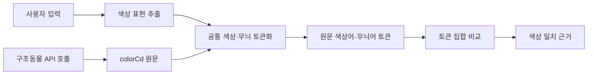

# 털색 단어 토큰화 및 매칭

## 목적

사용자 입력과 구조동물 API의 `colorCd`에서 실제로 적힌 색상·무늬 단어를 분리해 매칭한다. `갈색`과 `브라운`처럼 비슷한 표현도 서로 다른 토큰으로 보존하며, 번역·별칭 치환·임베딩·LLM 추측으로 토큰을 바꾸거나 확장하지 않는다.

## 처리 흐름

양쪽 입력에 동일한 단어 사전과 분해 규칙을 적용한다. API 호출은 `abandonmentPublic_v2` 응답의 `colorCd`를 사용한다. 원문은 근거와 재검토를 위해 보존하고, 매칭은 추출한 원문 토큰으로 수행한다.

## 토큰 결과와 매칭 규칙

토큰 결과는 색상어와 무늬어를 분리한 집합으로 다룬다. 각 토큰은 사전에 적힌 원문 표현 그대로이며, 서로 다른 별칭을 같은 토큰으로 합치지 않는다.

| 종류 | 추출 토큰 예 | 원문 예 |
| --- | --- | --- |
| 색상어 | `갈색`, `브라운`, `흰색`, `화이트`, `검정색`, `회색`, `레몬색`, `치즈색` | `갈색`, `화이트`, `검은색`, `레몬색`, `치즈색` |
| 무늬어 | `삼색`, `고등어`, `줄무늬`, `얼룩`, `턱시도`, `호반`, `태비`, `젖소`, `카오스` | `기타(삼색)`, `고등어태비`, `흰색/검은색 얼룩무늬`, `기타(턱시도)` |
| 미분류 원문 | 토큰 없음, 원문 유지 | `기타(믹스)`, `기타()` 등 |

- 토크나이저는 긴 단어부터 인식하고, `&`, `/`, `+`, 쉼표, 공백, 괄호 등 구분자와 붙여 쓴 색 표현을 처리한다. 예를 들어 `검은색흰색황토색조합`은 `검은색`, `흰색`, `황토색`으로 나눈다.
- `브라운`과 `갈색`, `화이트`와 `흰색`은 별개 토큰이다. 따라서 현재 매칭은 원문 토큰이 같은 경우만 잡으며, 별칭 간 매칭은 하지 않는다.
- 색이 없는 무늬 표현은 색상으로 바꾸지 않는다. 예를 들어 `평행·전체·부분줄무늬`는 `줄무늬` 무늬 토큰만 만든다.
- `턱시도`는 검정 단색이 아니다. 무늬 토큰으로 보존하고, 원문에 색상어가 따로 있을 때만 색상 토큰도 만든다.
- `기타(...)`는 괄호를 구분자로 처리해 안쪽 표현을 분석한다. 안쪽이 `믹스`처럼 사전에 없는 표현이면 색상 토큰을 만들지 않는다.
- 사전에 없는 표현은 임의로 가까운 색으로 바꾸지 않고 원문 미분류로 둔다. 사전은 `backend/agent/color_tokenizer.py`에서 관리하며, 새 어휘는 원자료를 확인한 뒤 추가한다.

### 추출 어휘 초안

아래 표현들은 추출 대상으로 등록된 독립 토큰이다. 표 안에서 같은 행에 있어도 서로 치환하거나 동일시하지 않는다.

| 참고상 색 계열 | 독립 추출 어휘 예 |
| --- | --- |
| 갈색 계열 | 갈색, 브라운, 밤색, 초코, 쵸콜릿색, 황갈색, 황토색 |
| 흰색 계열 | 하얀색, 하양, 백색, 화이트, 흰색 |
| 검정 계열 | 검은색, 검정색, 흑색, 블랙, 검정, 검은 |
| 회색 계열 | 회색, 그레이, 잿빛, 은색, 실버 |
| 크림 계열 | 크림, 베이지, 아이보리, 미색 |
| 노랑 계열 | 노랑, 노란색, 황색, 레몬색, 금색, 골드 |
| 주황 계열 | 주황, 오렌지, 치즈색, 치즈 |

색조가 겹치는 `살구색`, `탄`, `겨자색`, `고동색` 등은 원문을 검토한 뒤 추출 어휘에 추가한다. 한 원문에 복수 색이 있으면 모든 토큰을 보존한다. 예를 들어 `갈색&검정&흰색`을 `삼색`으로 바꾸지 않는다. `삼색`은 원문에 그 단어가 있을 때만 추출한다.

## DB에서 추출한 원문 색상값

2026-11-14 임시 DB의 고유 동물 50,000건을 집계했다. `colorCd` 원문은 1,181종이며 빈 값은 없었다. 아래는 빈도 상위 복합색·무늬 표현이다. 원문 전체와 건수는 [animal-color-combinations.tsv](data/animal-color-combinations.tsv)에 있다.

| 원문 `colorCd` | 건수 | 토큰화 예상 |
| --- | ---: | --- |
| `레몬색&흰색` | 2,901 | `레몬색`, `흰색` |
| `검은색흰색황토색조합` | 2,665 | `검은색`, `흰색`, `황토색` |
| `갈색&흰색` | 2,626 | `갈색`, `흰색` |
| `흰색/검은색 얼룩무늬` | 2,400 | `흰색`, `검은색`, `얼룩` |
| `검정&흰색` | 1,898 | `검정`, `흰색` |
| `갈색&검정` | 1,709 | `갈색`, `검정` |
| `평행·전체·부분줄무늬` | 1,703 | `줄무늬` |
| `갈색&검정&흰색` | 991 | `갈색`, `검정`, `흰색` |
| `흰색&황갈색` | 536 | `흰색`, `황갈색` |
| `검정&황갈색` | 530 | `검정`, `황갈색` |
| `기타(삼색)` | 464 | 무늬 `삼색` |
| `기타(고등어)` | 382 | 무늬 `고등어` |
| `기타(치즈)` | 381 | `치즈` |
| `기타(검/흰)` | 367 | `검`, `흰` |
| `검정 황갈색&흰색` | 321 | `검정`, `황갈색`, `흰색` |
| `기타(갈/검/흰)` | 292 | `갈색`, `검`, `흰` |

이 집계는 API 원문 표기의 분포를 보여 준다. 표의 토큰화 예상은 어휘 사전에 따른 추출 결과이며, 색조의 의미적 동일성을 뜻하지 않는다.

## 기존 코드와 적용 상태

`backend/agent/color_tokenizer.py`의 `tokenize_color_words()`는 긴 어휘부터 스캔해 색상어와 무늬어를 별도 집합으로 추출한다. 별칭을 표준색으로 합치지 않으며, 검색 점수 계산에서는 추출한 원문 토큰끼리 비교한다. 현재 점수 규칙은 요청 토큰과 공고 토큰 중 하나라도 겹치면 털색 점수를 부여한다. 완전·부분 일치별 차등 점수는 아직 적용하지 않았다.

사용자 입력과 API `colorCd` 양쪽은 같은 함수를 통과한다. 원문 값은 그대로 보존하고, 토큰화 규칙이 바뀌면 단위 테스트 및 `docs/test-report.md` 수정 이력을 함께 갱신한다.
