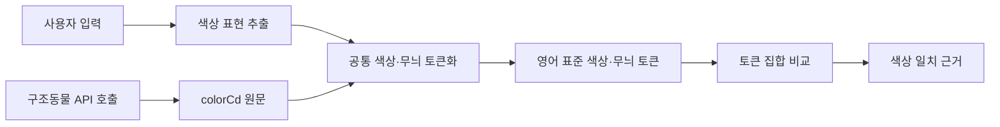

# 털색 단어 토큰화 및 매칭

## 목적

사용자 입력과 구조동물 API의 `colorCd`에서 색상·무늬 표현을 추출해 공통 영어 토큰으로 변환한다. 예를 들어 `검정`, `검은색`, `블랙`은 모두 `BLACK`이 된다. 이 사전 변환은 규칙 기반으로 수행하며, LLM이 새 색을 추정해 추가하지 않는다. 별도의 임베딩 순위는 기존 검색 규칙대로 동작한다.

## 처리 흐름

양쪽 입력에 동일한 별칭 사전과 분해 규칙을 적용한다. API 호출은 `abandonmentPublic_v2` 응답의 `colorCd`를 사용한다. 원문은 근거와 재검토를 위해 보존하고, 매칭은 변환된 영어 토큰으로 수행한다.

## 토큰 결과와 매칭 규칙

토큰 결과는 색상과 무늬를 분리한 집합으로 다룬다. 별칭은 같은 표준 토큰으로 합치되, 무늬 토큰을 색상 토큰으로 바꾸지 않는다.

| 종류 | 표준 토큰 예 | 원문 예 |
| --- | --- | --- |
| 색상 | `BLACK`, `WHITE`, `BROWN`, `YELLOW`, `GRAY`, `BLUE`, `GREEN` | `검정`, `검은색`, `화이트`, `브라운`, `레몬색`, `청색` |
| 무늬 | `TABBY`, `STRIPED`, `TUXEDO`, `SPOTTED`, `BRINDLE`, `TRICOLOR` | `고등어태비`, `줄무늬`, `기타(턱시도)`, `얼룩무늬`, `호반색`, `삼색` |
| 미분류 원문 | 토큰 없음, 원문 유지 | `기타(믹스)`, `기타()` 등 |

- 토크나이저는 긴 표현부터 인식하고, `&`, `/`, `+`, 쉼표, 공백 등 구분자와 붙여 쓴 복합 표현을 처리한다. `검은색흰색황토색조합`은 `BLACK`, `WHITE`, `OCHRE`가 된다.
- `검정`, `검정색`, `검은색`, `흑색`, `블랙`은 `BLACK`으로, `흰색`, `하얀색`, `백색`, `화이트`는 `WHITE`로 변환한다. 비슷한 표현은 사전에서 명시적으로 같은 ID에 연결한다.
- 색이 없는 무늬 표현은 색상으로 바꾸지 않는다. 예를 들어 `평행·전체·부분줄무늬`는 `STRIPED`만 만든다.
- `턱시도`는 검정 단색이 아니다. `TUXEDO` 무늬 토큰으로 보존하고, 원문에 검정·흰색 표현이 함께 있으면 색상 토큰도 추가한다.
- `기타(...)`는 접두 `기타(`와 닫는 `)`를 문자열 슬라이싱으로 제거한 뒤 안쪽 표현을 분석한다. 안쪽이 `믹스`처럼 사전에 없는 표현이면 색상 토큰을 만들지 않는다.
- 사전에 없는 표현은 임의로 가까운 색으로 바꾸지 않고 원문 미분류로 둔다. 사전은 `backend/agent/color_tokenizer.py`에서 관리하며, 새 어휘는 원자료를 확인한 뒤 추가한다.

### 표준 토큰 사전

아래는 사전에 같은 영어 토큰으로 연결한 대표 표현이다.

| 표준 토큰 | 원문 표현 예 |
| --- | --- |
| `BLACK` | 검정, 검정색, 검은색, 흑색, 블랙, 까만색 |
| `WHITE` | 흰색, 하양, 하얀색, 백색, 화이트 |
| `BROWN` | 갈색, 브라운, 밤색, 초코색, 초콜릿색, 고동색 |
| `TAN` | 황갈색, 옅은 황갈색, 탄, 누렁 |
| `YELLOW` | 노랑, 노란색, 황색, 레몬색, 옅은 황색 |
| `ORANGE` | 주황, 오렌지, 치즈색, 유자 |
| `GOLD` | 금색, 골드, 골든 |
| `GRAY` | 회색, 재색, 쥐색, 그레이, 은색, 실버 |
| `CREAM` | 크림색, 베이지, 아이보리, 미색 |
| `GREEN` / `BLUE` / `TEAL` | 녹색·초록색 / 파란색·청색 / 청록색 |
| `RED` / `PINK` / `PURPLE` | 빨강·적색 / 분홍·핑크 / 보라·라일락 |
| `APRICOT` / `MUSTARD` / `OCHRE` | 살구색 / 겨자색 / 황토색 |
| `TABBY` / `TUXEDO` / `BRINDLE` | 고등어·태비 / 턱시도 / 호반색·브린들 |
| `SPOTTED` / `STRIPED` / `TRICOLOR` | 얼룩·반점 / 줄무늬 / 삼색·세가지색 |

한 원문에 여러 색이나 무늬가 있으면 모든 토큰을 보존한다. 예를 들어 `갈색&검정&흰색`은 `BROWN`, `BLACK`, `WHITE`이며, `TRICOLOR`로 축약하지 않는다. `황토색`, `살구색`, `겨자색`은 추측성 동의어로 다른 기본색에 합치지 않고 각각 `OCHRE`, `APRICOT`, `MUSTARD`로 구분한다.

## DB에서 추출한 원문 색상값

2026-11-14 임시 DB의 고유 동물 50,000건을 집계했다. `colorCd` 원문은 1,181종이며 빈 값은 없었다. 아래는 빈도 상위 복합색·무늬 표현이다. 원문 전체와 건수는 [animal-color-combinations.tsv](data/animal-color-combinations.tsv)에 있다.

| 원문 `colorCd` | 건수 | 토큰화 예상 |
| --- | ---: | --- |
| `레몬색&흰색` | 2,901 | `YELLOW`, `WHITE` |
| `검은색흰색황토색조합` | 2,665 | `BLACK`, `WHITE`, `OCHRE` |
| `갈색&흰색` | 2,626 | `BROWN`, `WHITE` |
| `흰색/검은색 얼룩무늬` | 2,400 | `WHITE`, `BLACK`, `SPOTTED` |
| `검정&흰색` | 1,898 | `BLACK`, `WHITE` |
| `갈색&검정` | 1,709 | `BROWN`, `BLACK` |
| `평행·전체·부분줄무늬` | 1,703 | `STRIPED` |
| `갈색&검정&흰색` | 991 | `BROWN`, `BLACK`, `WHITE` |
| `흰색&황갈색` | 536 | `WHITE`, `TAN` |
| `검정&황갈색` | 530 | `BLACK`, `TAN` |
| `기타(삼색)` | 464 | 무늬 `TRICOLOR` |
| `기타(고등어)` | 382 | 무늬 `TABBY` |
| `기타(치즈)` | 381 | `ORANGE` |
| `기타(검/흰)` | 367 | `BLACK`, `WHITE` |
| `검정 황갈색&흰색` | 321 | `BLACK`, `TAN`, `WHITE` |
| `기타(갈/검/흰)` | 292 | `BROWN`, `BLACK`, `WHITE` |

이 집계는 API 원문 표기의 분포를 보여 준다. 표의 토큰화 예상은 어휘 사전에 따른 결과다.

### TSV 전체 커버리지

TSV의 고유 원문 1,181개를 검사한다. 1,157개는 하나 이상의 영어 토큰으로 변환되고, 24개는 부적절하거나 색상 정보를 주지 않는 값이라 `EXCLUDED_COLOR_VALUES`에 이유와 함께 명시한다. 제외 원문은 `기타(믹스)`, 빈 값·기타 표기, 종·품종 이름, 털색 판독 불가, 의미를 확정하기 어려운 오기 등이다. 제외 행은 243건이며, 나머지 49,757건은 토큰화된다.

`backend/tests/test_color_tokenizer.py`는 TSV의 모든 고유 원문이 토큰화되거나 명시적 제외 목록에 있는지 검사한다. TSV에 없는 제외 항목도 허용하지 않는다.

## 기존 코드와 적용 상태

`backend/agent/color_tokenizer.py`의 `tokenize_color_words()`는 긴 어휘 우선 분해와 연결된 약식 색상 표현 분리를 거쳐 색상·무늬 별칭을 영어 ID로 변환한다. 사용자와 공고 원문에 같은 함수를 적용한다. 검색 점수는 요청 토큰과 공고 토큰 중 하나라도 겹치면 털색 점수를 부여한다. 완전·부분 일치별 차등 점수는 아직 적용하지 않았다. 정규화 규칙 변경에 따라 검색 캐시 버전도 갱신한다.

원문 값은 그대로 보존하고 별도 색상 정규화 테이블은 두지 않는다. 토큰 사전이나 분해 규칙이 바뀌면 TSV 전체 커버리지 단위 테스트와 `docs/test-report.md` 수정 이력을 함께 갱신한다.
