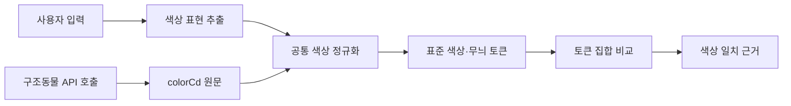

# 털색 정규화 및 단어 기반 매칭

## 목적

사용자가 적은 털색 표현과 구조동물 API의 `colorCd`를 같은 색상 용어로 바꿔 단어 기반으로 매칭한다. 임베딩이나 LLM의 추측으로 색을 확장하지 않는다. 사용자가 실제로 입력한 색상 단어와 API 원문에서 확인한 단어만 비교한다.

## 처리 흐름

양쪽 입력에 동일한 정규화 사전과 분해 규칙을 적용한다. API 호출은 `abandonmentPublic_v2` 응답의 `colorCd`를 사용한다. 원문은 근거와 재검토를 위해 보존하고, 매칭은 정규화 결과로 수행한다.

## 정규화 결과와 매칭 규칙

정규화 결과는 하나의 색상 문자열이 아니라 여러 색과 무늬를 담는 토큰 집합으로 다룬다.

| 종류 | 표준 토큰 예 | 원문 예 |
| --- | --- | --- |
| 기본색 | `갈색`, `흰색`, `검정`, `회색`, `크림`, `노랑`, `주황` | `갈색`, `화이트`, `검은색`, `레몬색`, `치즈색` |
| 무늬·배색 | `삼색`, `고등어`, `줄무늬`, `얼룩`, `턱시도`, `호반`, `태비`, `젖소`, `카오스` | `기타(삼색)`, `고등어태비`, `흰색/검은색 얼룩무늬`, `기타(턱시도)` |
| 미분류 원문 | 색상 토큰 없음, 원문 유지 | `기타(믹스)`, `기타()` 등 |

- 사용자가 한 색을 말하면 양쪽의 같은 표준 색 토큰이 있을 때 색상 일치로 본다.
- 사용자가 여러 색이나 색과 무늬를 함께 명시하면, 추출된 요청 토큰을 API 토큰이 모두 포함해야 완전 일치로 본다. 일부만 겹치면 부분 일치 근거로 남긴다.
- 색이 없는 무늬 표현은 색상으로 바꾸지 않는다. 예를 들어 `평행·전체·부분줄무늬`는 줄무늬 토큰만 만든다.
- `턱시도`는 검정 단색이 아니다. 무늬 토큰으로 보존하고, 실제 원문에 검정·흰색이 따로 쓰인 경우에만 두 색 토큰도 만든다.
- `기타(...)`는 껍데기 표기로 보고 안쪽 표현을 분석한다. 안쪽이 `믹스`처럼 색을 특정하지 않으면 색 토큰을 생성하지 않는다.
- 색 이름 사전은 긴 표현부터 인식하고, `&`, `/`, `+`, 쉼표, 공백 및 붙여 쓴 색 표현을 처리한다. 단순 부분 문자열 검색만으로는 복합색을 확정하지 않는다.
- 안전한 별칭만 표준색으로 치환한다. 현재 색상 스키마에 대응하지 않는 희귀 색은 임의로 가까운 색으로 바꾸지 않고 원문 미분류로 둔다. 새 표준색을 추가할 때는 스키마·프롬프트·검색 규칙을 함께 갱신한다.

### 별칭 초안

| 표준 토큰 | 별칭 예 |
| --- | --- |
| `갈색` | 브라운, 밤색, 초코, 쵸콜릿색, 황갈색, 황토색 |
| `흰색` | 하얀색, 하양, 백색, 백, 화이트 |
| `검정` | 검은색, 검정색, 흑색, 흑, 블랙 |
| `회색` | 그레이, 잿빛, 은색, 실버 |
| `크림` | 베이지, 아이보리, 미색 |
| `노랑` | 노란색, 황색, 레몬색, 금색, 골드 |
| `주황` | 오렌지, 치즈색 |

별칭은 표준화 후보 사전이다. 특히 색조가 겹치는 `살구색`, `탄`, `겨자색`, `고동색` 등은 자동 치환하지 않고 원문을 검토한 뒤 등록한다. 한 원문에 복수 색이 있으면 모든 색 토큰을 보존한다. 예를 들어 `갈색&검정&흰색`을 단일 `삼색`으로 축약하지 않는다. 명시적인 삼색 표기나 분명한 세 색 조합은 색 토큰과 함께 `삼색` 배색 토큰을 추가할 수 있다.

## DB에서 추출한 원문 색상값

2026-11-14 임시 DB의 고유 동물 50,000건을 집계했다. `colorCd` 원문은 1,181종이며 빈 값은 없었다. 아래는 빈도 상위 복합색·무늬 표현이다. 원문 전체와 건수는 [animal-color-combinations.tsv](data/animal-color-combinations.tsv)에 있다.

| 원문 `colorCd` | 건수 | 정규화 검토 |
| --- | ---: | --- |
| `레몬색&흰색` | 2,901 | 노랑 + 흰색 |
| `검은색흰색황토색조합` | 2,665 | 검정 + 흰색 + 갈색 후보 |
| `갈색&흰색` | 2,626 | 갈색 + 흰색 |
| `흰색/검은색 얼룩무늬` | 2,400 | 흰색 + 검정 + 얼룩 |
| `검정&흰색` | 1,898 | 검정 + 흰색 |
| `갈색&검정` | 1,709 | 갈색 + 검정 |
| `평행·전체·부분줄무늬` | 1,703 | 줄무늬만, 기본색 미상 |
| `갈색&검정&흰색` | 991 | 갈색 + 검정 + 흰색 + 삼색 배색 후보 |
| `흰색&황갈색` | 536 | 흰색 + 갈색 후보 |
| `검정&황갈색` | 530 | 검정 + 갈색 후보 |
| `기타(삼색)` | 464 | 삼색 배색 |
| `기타(고등어)` | 382 | 고등어 무늬 |
| `기타(치즈)` | 381 | 주황 후보 |
| `기타(검/흰)` | 367 | 검정 + 흰색 |
| `검정 황갈색&흰색` | 321 | 검정 + 갈색 후보 + 흰색 |
| `기타(갈/검/흰)` | 292 | 갈색 + 검정 + 흰색 + 삼색 배색 후보 |

이 집계는 API 원문 표기의 분포를 보여 주며, 표의 정규화 검토 열은 확정 정답 라벨이 아니다. 별칭과 배색 처리 규칙은 실제 매칭 결과를 확인하면서 검증해야 한다.

## 기존 코드와 적용 상태

현재 `backend/agent/ranking.py`의 `COLOR_SYNONYMS`와 `color_tokens()`는 문자열 포함 여부로 토큰을 찾는다. 이 방식은 `검은색흰색황토색조합`처럼 붙여 쓴 표현에서 일부 색을 놓치거나, `턱시도`를 검정 단색으로 처리하는 문제가 있다. 이 문서는 다음 개선의 데이터 근거와 동작 규칙을 정한다. 정규화 구현은 아직 이 설계대로 변경되지 않았다.

후속 구현에서는 사용자 입력과 API `colorCd` 양쪽이 동일한 공통 함수를 통과하게 하고, 원문·기본색 토큰·무늬 토큰을 분리해 기록한다. 색상 별칭이나 분해 규칙이 바뀌면 단위 테스트 및 `docs/test-report.md` 수정 이력을 함께 갱신한다.
